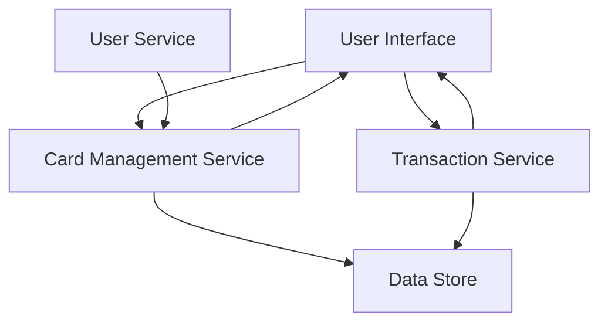

#### 1. High-Level Design

- **Summary:** This epic delivers a unified interface for users to view and manage multiple credit cards, providing card-specific insights including individual credit limits, available credit, outstanding balances, and card-wise spending analysis. The solution consolidates all credit card information in a single location, eliminating the need to access multiple banking platforms.

- **Component Flow:**

- **Integration Points:**
  - **Upstream:** User Service (for user authentication and card-user association)
  - **Internal:** Card Management Service (card data storage/retrieval), Transaction Service (card-specific transaction data)
  - **Downstream:** Data Store (encrypted card information and transaction records)

- **Key Assumptions:**
  - Card data is provided in a standardized format from the Card Management Service; card updates occur asynchronously with near-real-time refresh intervals.
  - Transaction Service provides pre-aggregated card-wise spending metrics rather than raw transaction-level data for performance optimization.

- **NFR Highlights:** System must support at least 10 credit cards per user; card data retrieval must complete within 1 second; data must be securely stored and encrypted at rest; UI must maintain usability with increasing number of cards.

- **Data Flow:** User authenticates via User Service → UI requests card portfolio data → Card Management Service retrieves card details from Data Store (encrypted) → Transaction Service fetches card-specific spending data → Aggregated data (card limits, balances, spending) is returned to UI → User views consolidated multi-card dashboard with per-card metrics and insights.

#### 2. Validation Report

- **Requirements Coverage:** The design fully addresses the epic's scope including multiple credit card display, card-wise spend analysis, individual card credit limit tracking, per-card available credit calculation, per-card outstanding balance display, and card details visualization. All NFRs (10 cards per user, 1-second retrieval, encryption at rest, scalable UI) are incorporated into the architecture. Integration dependencies with Card Management Service, Transaction Service, and User Service are explicitly mapped. Out-of-scope items (payments, card activation, applications) are clearly excluded from the design.