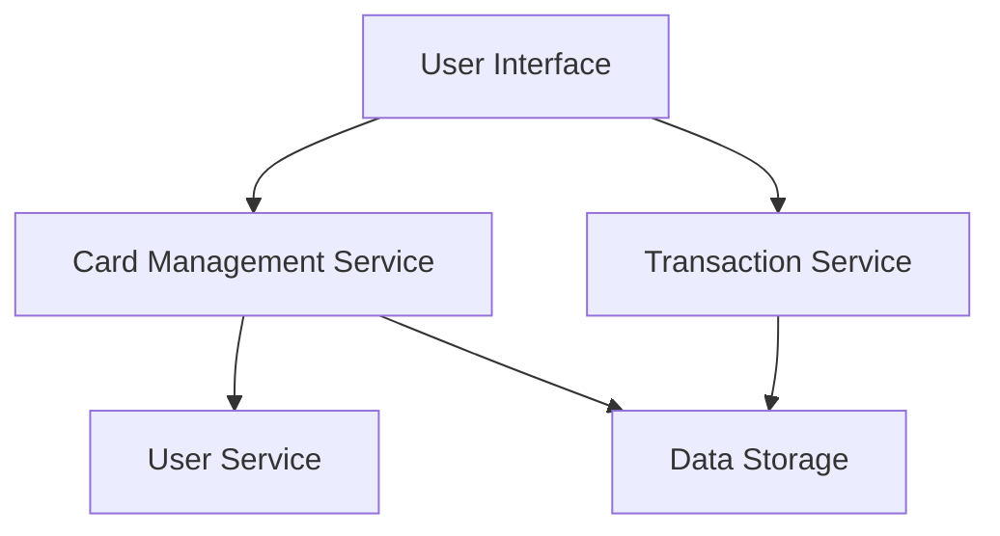

#### 1. High-Level Design

- **Summary:** This epic delivers a unified interface for managing multiple credit cards (up to 10+ per user), displaying card-specific details including credit limits, available credit, outstanding balances, and card-wise spending analysis. The system consolidates card data from various sources and presents a centralized view for simplified multi-card management.

- **Component Flow:**

- **Integration Points:**
  - **Upstream:** User Service (for user authentication and card-user association)
  - **Downstream:** Card Management Service (card data storage and retrieval), Transaction Service (card-specific transaction data)

- **Key Assumptions:** 
  - Card data is updated via batch synchronization or API calls from external card providers (frequency not specified, assumed daily or real-time).
  - Card information includes standard fields (card number, type, issuer, limits) in a predefined schema.

- **NFR Highlights:** System must support at least 10 credit cards per user; card data retrieval within 1 second; secure storage with encryption at rest.

- **Data Flow:** User authenticates via User Service → UI requests card list from Card Management Service → Service retrieves card details from Data Storage → Transaction Service provides card-specific spending data → Aggregated data (card details + spending) is displayed in UI with per-card metrics (credit limit, available credit, outstanding balance).

#### 2. Validation Report

- **Requirements Coverage:** The design addresses all core requirements: multiple card display, card-wise spend analysis, individual card tracking (credit limit, available credit, outstanding balance), and secure data storage. The architecture supports the stated NFRs (10+ cards, 1-second retrieval, encryption). The modular design allows for scalability and maintainability.