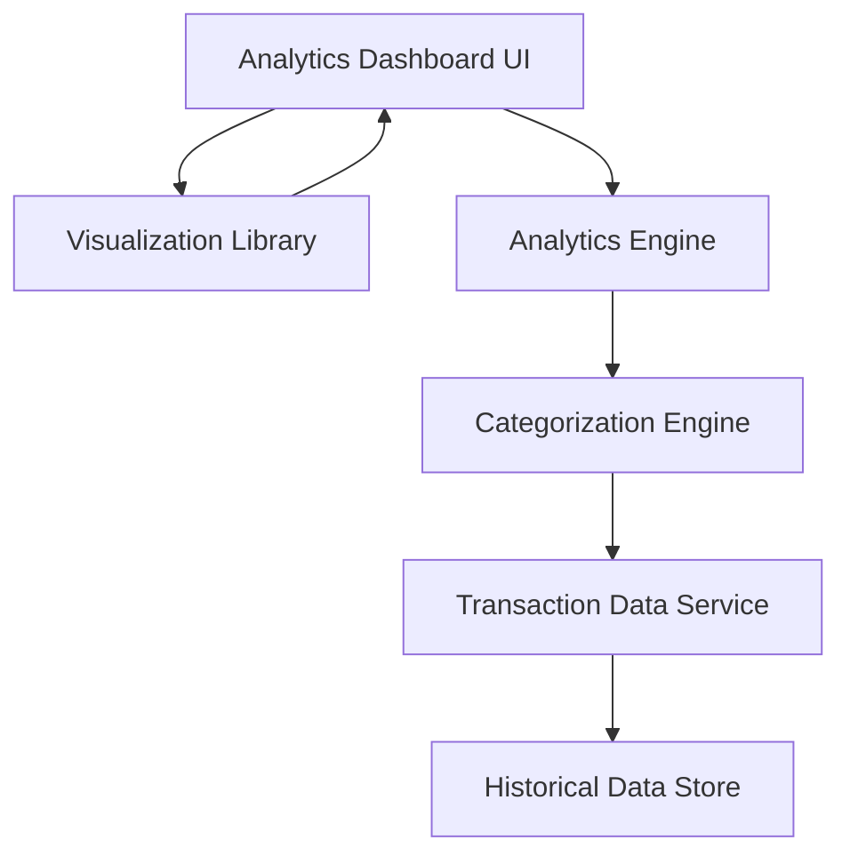

#### 1. High-Level Design

- **Summary:** This epic provides interactive analytics and visualization capabilities for understanding spending patterns through category-wise analysis across nine predefined categories (Food & Dining, Fuel, Shopping, Travel, Entertainment, Utilities, Healthcare, Education, Miscellaneous). It includes monthly spend trend analysis and visual representations to help users identify spending habits and adjust financial behavior.

- **Component Flow:**

- **Integration Points:**
  - **Upstream:** Transaction Data Service (for historical spending data and transaction records)
  - **Upstream:** Categorization Engine (for transaction classification into predefined categories)
  - **Downstream:** Visualization Library (for chart rendering and interactive components)

- **Key Assumptions:**
  - Transaction categorization is automated using predefined rules or ML models with manual override capability
  - Historical data aggregation is pre-computed for common time periods (monthly, quarterly) to meet rendering performance requirements

- **NFR Highlights:** Analytics visualizations must render within 1.5 seconds; System must handle transaction history of at least 12 months; Charts must be interactive and responsive across all devices

#### 2. Validation Report

- **Requirements Coverage:** The design comprehensively covers all scope elements including category-wise spending visualization, monthly spend trend charts, interactive analytics dashboard, nine spending categories support, transaction categorization, spending pattern analysis, and data visualization components. The architecture supports the NFR requirements for sub-1.5-second rendering through pre-aggregation strategies and efficient visualization libraries. The 12-month transaction history requirement is addressed through the historical data store component. Responsive and interactive chart requirements are met through modern visualization library integration.