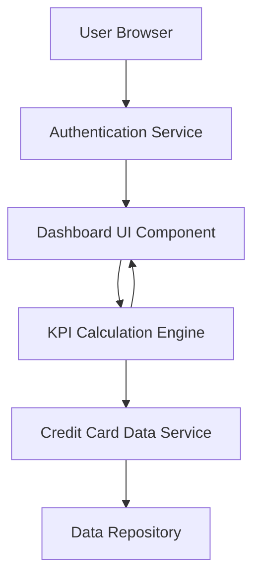

#### 1. High-Level Design

- **Summary:** This epic delivers a consolidated dashboard that displays key performance indicators (KPIs) for all user credit cards, including monthly spend, total credit limit, available credit, and outstanding amounts. The dashboard provides real-time visibility into the credit card portfolio through a modern, responsive interface enabling informed financial decision-making.

- **Component Flow:**

- **Integration Points:**
  - **Upstream:** User Authentication Service (for secure access and user identity verification)
  - **Downstream:** Credit Card Data Service (for fetching card details, balances, and transaction data)

- **Key Assumptions:**
  - Data refresh frequency is assumed to be near real-time (polling or event-driven updates every 30-60 seconds)
  - KPI calculations are performed server-side and cached for performance optimization

- **NFR Highlights:** Dashboard must be responsive across all device types (mobile, tablet, desktop); Page load time must be under 2 seconds; UI must support real-time data refresh

#### 2. Validation Report

- **Requirements Coverage:** The design fully covers the epic's stated scope including dashboard interface design, monthly spend display, total credit limit calculation, available credit tracking, outstanding amount display, responsive layout implementation, and multi-card consolidated view. All NFRs regarding responsiveness, page load time, and real-time refresh are addressed through the component architecture. Integration dependencies with credit card data service and authentication service are explicitly mapped in the design.