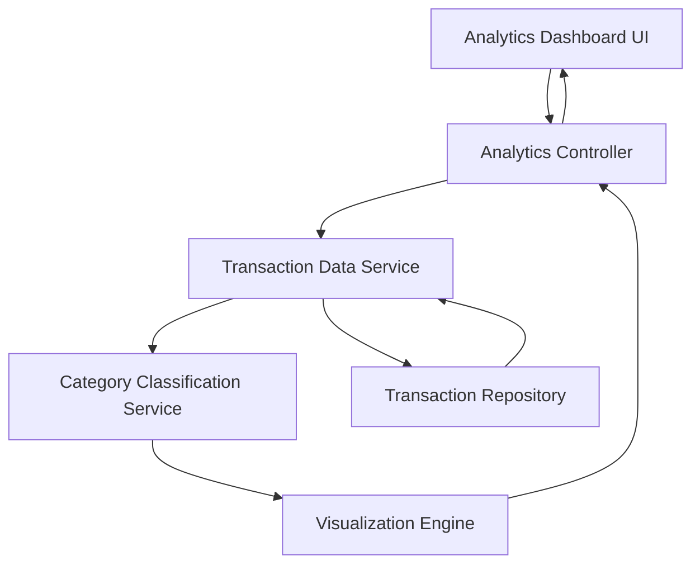

#### 1. High-Level Design

- **Summary:** This epic delivers comprehensive transaction analytics with deep spending insights through interactive visualizations. Users can analyze transactions with category-wise breakdowns across nine distinct categories (Food & Dining, Fuel, Shopping, Travel, Entertainment, Utilities, Healthcare, Education, Miscellaneous), enabling data-driven budget optimization and spending pattern identification.

- **Component Flow:**

- **Integration Points:**
  - **Upstream:** Transaction data service or repository providing detailed transaction records with category information
  - **Potential:** Data categorization service or algorithm for automatic transaction classification
  - **Downstream:** Interactive charting library (e.g., D3.js, Chart.js) for visualization rendering
  - **Data Exchange:** Transaction query API with filtering by date range, category, and card

- **Key Assumptions:**
  - Transactions are pre-categorized or a categorization algorithm exists to classify transactions into the nine defined categories
  - Transaction data includes minimum required fields: amount, date, merchant, and category for accurate analytics

- **NFR Highlights:** Analytics visualizations must be interactive and responsive; category classification must be accurate and consistent; system must handle large transaction volumes efficiently; charts must render quickly without performance degradation

- **Data Flow:** User accesses analytics dashboard → Analytics Controller requests transaction data from Transaction Data Service → Service retrieves raw transactions from Transaction Repository → Category Classification Service processes and groups transactions by nine categories → Visualization Engine generates interactive charts showing category-wise spending patterns → User interacts with visualizations (filter by date, category, drill-down) → Dynamic updates trigger re-calculation and chart refresh → Insights displayed showing spending distribution, trends, and patterns across categories

#### 2. Validation Report

- **Requirements Coverage:** The design fully addresses the epic's scope by implementing category-wise spending visualization, interactive analytics charts, transaction data display, and spending pattern analysis across all nine specified categories (Food & Dining, Fuel, Shopping, Travel, Entertainment, Utilities, Healthcare, Education, Miscellaneous). The architecture satisfies NFRs through dedicated services for category classification and visualization rendering, ensuring interactive responsiveness, accurate classification, efficient handling of large transaction volumes, and quick chart rendering. The modular design allows independent scaling of transaction processing and visualization components to maintain performance under load.