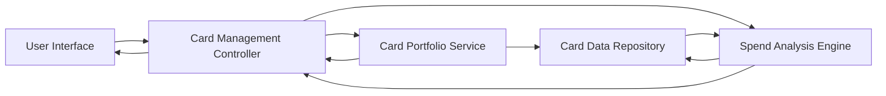

#### 1. High-Level Design

- **Summary:** This epic enables unified management and monitoring of multiple credit cards through a consolidated interface. Users can view all cards in one place, access card-specific details, perform card-wise spend analysis, and visualize monthly spend trends across their portfolio to optimize card usage and identify utilization patterns.

- **Component Flow:**

- **Integration Points:**
  - **Upstream:** Credit card data repository or service providing card details, balances, and transaction history for multiple cards
  - **Downstream:** Visualization components for spend trends and card comparison
  - **Data Exchange:** Multi-card data aggregation service with filtering and sorting capabilities

- **Key Assumptions:**
  - Each credit card has a unique identifier for tracking and display purposes
  - Transaction history is available per card with sufficient granularity for monthly trend analysis (minimum daily transaction records)

- **NFR Highlights:** System must support multiple cards simultaneously with performant data retrieval; UI must clearly distinguish between different cards and their respective data

- **Data Flow:** User accesses multi-card view → Card Management Controller fetches portfolio data from Card Portfolio Service → Service retrieves all associated cards from Card Data Repository → User selects specific card for analysis → Spend Analysis Engine processes transaction history for selected card → Monthly spend trends calculated and aggregated → Card-wise spending patterns and comparisons displayed in UI with visual differentiation between cards

#### 2. Validation Report

- **Requirements Coverage:** The design comprehensively addresses the epic's scope including multiple credit card display, card-wise spend analysis, monthly spend trends visualization, card detail views, and consolidated portfolio overview. The architecture supports performant handling of multiple cards as specified in NFRs through dedicated services for portfolio management and spend analysis. The clear separation between Card Portfolio Service and Spend Analysis Engine enables scalability and independent optimization of card management and analytics functions.