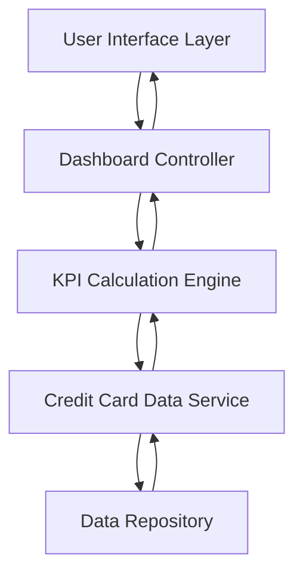

#### 1. High-Level Design

- **Summary:** This epic delivers a responsive dashboard providing consolidated credit card portfolio visibility through four critical KPIs: Monthly Spend, Total Credit Limit, Available Credit, and Outstanding Amount. The dashboard enables real-time monitoring of credit card health across all devices, empowering users to track financial status and make informed decisions at a glance.

- **Component Flow:**

- **Integration Points:** 
  - **Upstream:** Credit card data source or mock data service providing card balances, credit limits, and transaction data
  - **Downstream:** Responsive UI framework for multi-device rendering
  - **Data Exchange:** RESTful API or service layer for real-time data retrieval

- **Key Assumptions:** 
  - Credit card data is available via a standardized API with consistent data formats (JSON/XML) for balances, limits, and transactions
  - Data refresh occurs at regular intervals (assumed 5-15 minutes) or triggered by user action to maintain near real-time accuracy

- **NFR Highlights:** Dashboard must be responsive across multiple device form factors; page load time optimized for quick access; near real-time data refresh for current financial status

- **Data Flow:** User accesses dashboard → Dashboard Controller requests KPI data → KPI Calculation Engine aggregates data from Credit Card Data Service → Data Service retrieves raw transaction and balance data from Data Repository → Calculated KPIs (Monthly Spend, Total Credit Limit, Available Credit, Outstanding Amount) returned to UI → Dashboard displays consolidated view with auto-refresh capability

#### 2. Validation Report

- **Requirements Coverage:** The design fully covers the epic's stated scope by addressing all four KPIs (Monthly Spend, Total Credit Limit, Available Credit, Outstanding Amount), responsive layout, and multi-device support. The architecture supports near real-time data refresh and optimized page load times as specified in NFRs. The separation of concerns between UI, controller, calculation engine, and data service ensures maintainability and scalability.