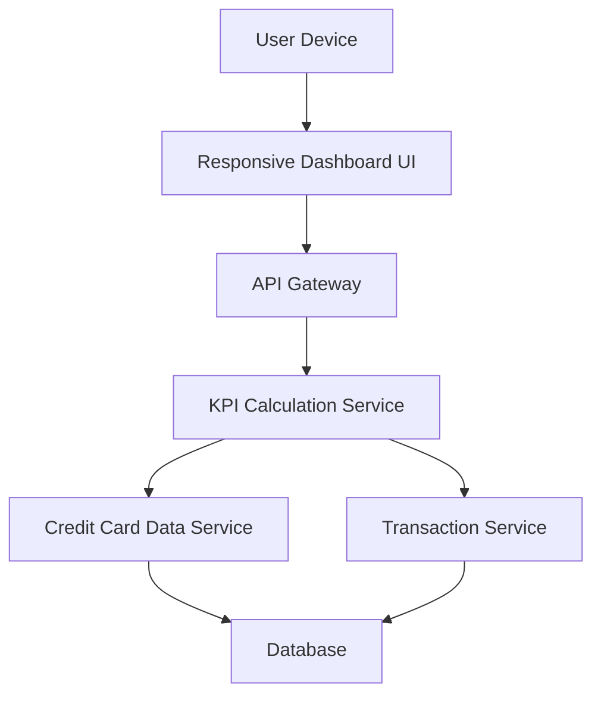

#### 1. High-Level Design

- **Summary:** This epic encompasses the development of a modern, responsive dashboard providing users with a consolidated view of their credit card portfolio through key performance indicators. The dashboard displays critical financial metrics including monthly spend, total credit limit, available credit, and outstanding amount, enabling users to monitor overall credit card financial health at a glance across all devices.

- **Component Flow:**

- **Integration Points:** 
  - Credit card data service for retrieving card balances and limits
  - Transaction service for calculating monthly spend and outstanding amounts

- **Key Assumptions:** 
  - KPI aggregation occurs across all user-owned cards with real-time or near-real-time data refresh
  - Outstanding amount calculation includes all pending and posted transactions

- **NFR Highlights:** Dashboard must load within 2 seconds; support responsive design for mobile, tablet, and desktop viewports; system must handle real-time data refresh for KPI updates

#### 2. Validation Report

- **Requirements Coverage:** The design addresses all scope elements including monthly spend KPI display, total credit limit aggregation, available credit calculation and display, outstanding amount tracking, responsive dashboard layout, and consolidated multi-card view. The architecture supports the specified NFRs for performance (2-second load time), responsive design across viewports, and real-time data refresh through dedicated KPI calculation and data services.