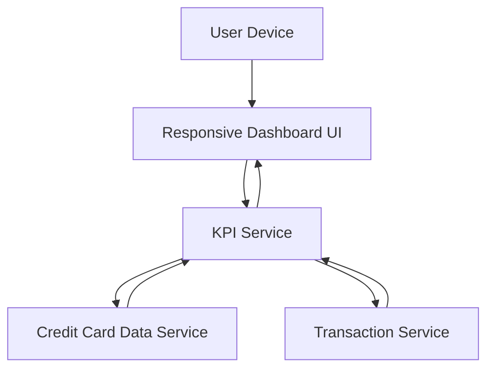

#### 1. High-Level Design

- **Summary:** This epic develops a modern, responsive dashboard providing a consolidated view of credit card portfolio through key performance indicators. The dashboard displays critical financial metrics (monthly spend, total credit limit, available credit, outstanding amount), enabling users to monitor overall credit card financial health at a glance across all devices.

- **Component Flow:**

- **Integration Points:** 
  - **Upstream:** Credit card data service for retrieving card balances and limits
  - **Upstream:** Transaction service for calculating monthly spend and outstanding amounts
  - **Downstream:** Responsive dashboard UI rendering KPIs across mobile, tablet, and desktop

- **Key Assumptions:** 
  - Real-time data refresh is triggered by user action or periodic polling; KPI calculations are server-side
  - Responsive design framework supports mobile, tablet, and desktop viewports with consistent UX

- **NFR Highlights:** Dashboard must load within 2 seconds; support responsive design for mobile, tablet, and desktop viewports; system must handle real-time data refresh for KPI updates

#### 2. Validation Report

- **Requirements Coverage:** The design comprehensively covers all scope elements including monthly spend KPI display, total credit limit aggregation, available credit calculation and display, outstanding amount tracking, responsive dashboard layout, and consolidated multi-card view. The architecture demonstrates integration with required credit card data and transaction services, and fully supports the specified NFRs for 2-second load time, responsive design across three viewport types, and real-time data refresh capability.