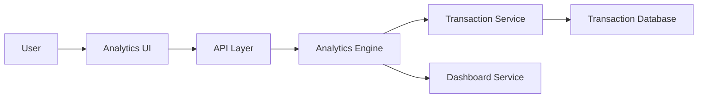

#### 1. High-Level Design

- **Summary:** This epic delivers interactive visualizations and analytical capabilities to help users understand spending patterns across different categories. Users can view monthly spend trends and analyze expenses across 9 predefined categories (Food & Dining, Fuel, Shopping, Travel, Entertainment, Utilities, Healthcare, Education, Miscellaneous) with visual representations enabling pattern identification and trend tracking.

- **Component Flow:**

- **Integration Points:** 
  - Transaction service for categorized transaction data
  - Analytics engine for data aggregation and trend calculation
  - Dashboard service for visualization rendering

- **Key Assumptions:** 
  - Historical data for at least 12 months is available as specified in NFRs
  - Categorization logic is pre-applied to transactions before analytics processing

- **NFR Highlights:** Analytics visualizations must render within 3 seconds; system must support historical data analysis for at least 12 months; charts must be interactive and responsive across all device types

#### 2. Validation Report

- **Requirements Coverage:** The design covers all scope elements including category-wise spending visualization, monthly spend trend analysis, interactive charts and graphs, nine spending categories tracking, transaction categorization display, and spending pattern identification. The architecture supports the NFRs for performance (3-second rendering), historical data retention (12 months), and cross-device responsiveness through dedicated analytics and dashboard services.