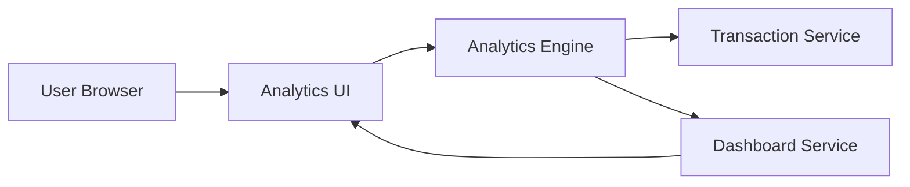

#### 1. High-Level Design

- **Summary:** This epic provides interactive visualizations and analytical capabilities for understanding spending patterns across categories. Users can view monthly spend trends and analyze expenses across 9 predefined categories (Food & Dining, Fuel, Shopping, Travel, Entertainment, Utilities, Healthcare, Education, Miscellaneous), gaining actionable insights into financial behavior for budget optimization.

- **Component Flow:**

- **Integration Points:** 
  - **Upstream:** Transaction service for categorized transaction data
  - **Upstream:** Analytics engine for data aggregation and trend calculation
  - **Upstream:** Dashboard service for visualization rendering
  - **Downstream:** Interactive analytics interface presenting insights to user

- **Key Assumptions:** 
  - Historical transaction data for at least 12 months is available; transactions are pre-categorized or categorization is handled upstream
  - Dashboard service provides visualization rendering capabilities compatible with responsive design requirements

- **NFR Highlights:** Analytics visualizations must render within 3 seconds; system must support historical data analysis for at least 12 months; charts must be interactive and responsive across all device types

#### 2. Validation Report

- **Requirements Coverage:** The design fully addresses all scope elements including category-wise spending visualization, monthly spend trend analysis, interactive charts and graphs, tracking across 9 spending categories, transaction categorization display, and spending pattern identification. The architecture integrates with all specified dependencies (transaction service, analytics engine, dashboard service) and satisfies the NFRs for rendering performance (3 seconds), historical data support (12 months), and responsive interactivity across devices.