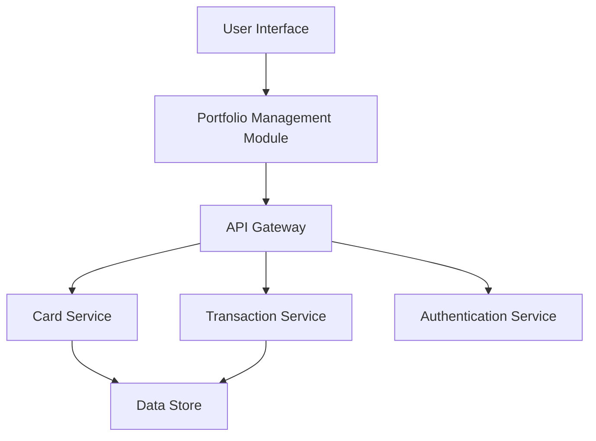

#### 1. High-Level Design

- **Summary:** This epic enables users to manage and view multiple credit cards within a unified interface, providing individual card details, card-wise spend analysis, and comprehensive financial status for each card. Users can compare and manage their credit card portfolio efficiently by viewing credit limit, current balance, available credit, and spending patterns per card.

- **Component Flow:**

- **Integration Points:** 
  - Credit card data service for card information retrieval
  - User authentication service for card ownership verification
  - Transaction service for card-specific spending data

- **Key Assumptions:** 
  - Portfolio supports at least 10 cards per user as specified in NFRs
  - Card comparison logic is implemented client-side or via a dedicated comparison service

- **NFR Highlights:** System must support management of at least 10 credit cards per user; card data retrieval must complete within 1 second; interface must maintain performance with multiple cards loaded simultaneously

#### 2. Validation Report

- **Requirements Coverage:** The design addresses all scope elements including multiple credit card display, card-wise spend analysis, individual card details view, per-card credit limit tracking, per-card available credit display, and card comparison capabilities. The architecture supports the specified NFRs for scalability (10+ cards), performance (1-second retrieval), and simultaneous card loading through efficient service orchestration.