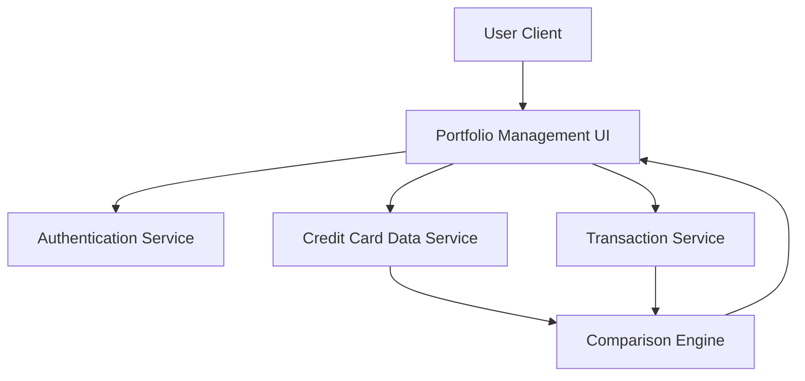

#### 1. High-Level Design

- **Summary:** This epic delivers a unified interface for managing and viewing multiple credit cards, enabling card-wise spend analysis and comprehensive financial status tracking. Users can view each card's credit limit, current balance, available credit, and spending patterns, facilitating portfolio comparison and optimization of credit card utilization.

- **Component Flow:**

- **Integration Points:** 
  - **Upstream:** Credit card data service for card information retrieval
  - **Upstream:** User authentication service for card ownership verification
  - **Upstream:** Transaction service for card-specific spending data
  - **Downstream:** Portfolio management UI with comparison capabilities

- **Key Assumptions:** 
  - Card data retrieval completes within 1 second per NFR; comparison logic is client-side or provided by lightweight service
  - System supports at least 10 cards per user as specified; data model allows efficient querying of multiple cards

- **NFR Highlights:** System must support management of at least 10 credit cards per user; card data retrieval must complete within 1 second; interface must maintain performance with multiple cards loaded simultaneously

#### 2. Validation Report

- **Requirements Coverage:** The design comprehensively addresses all scope elements including multiple credit card display, card-wise spend analysis, individual card details, per-card credit limit tracking, per-card available credit display, and card comparison capabilities. The architecture integrates with all specified dependencies (credit card data service, authentication service, transaction service) and meets the stated NFRs for capacity (10+ cards), performance (1-second retrieval), and concurrent card loading.