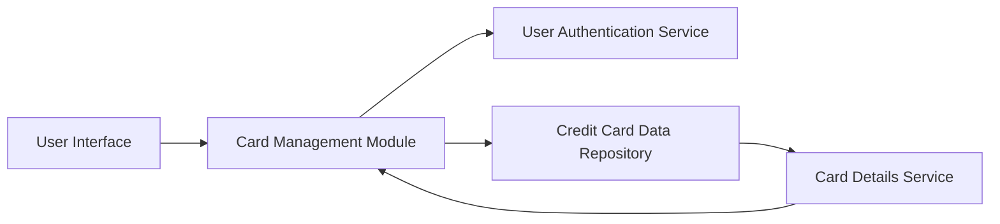

#### 1. High-Level Design

- **Summary:** This epic enables users to manage and monitor multiple credit cards within a unified platform. Users can view all cards in a consolidated interface, access card-specific details, track individual card performance, and seamlessly switch between cards. The feature provides comprehensive oversight of each card's status, limits, and usage patterns.

- **Component Flow:**

- **Integration Points:** 
  - **Upstream:** Credit card data repository/service for retrieving multiple card information
  - **Upstream:** User authentication service for card ownership validation
  - **Downstream:** Card management interface displays consolidated card data to user

- **Key Assumptions:** 
  - Card ownership is validated via authentication service; user can have varying numbers of cards with no fixed upper limit in data model
  - Card data includes standard attributes (card number, limit, balance, issuer) accessible via API

- **NFR Highlights:** System must handle display of multiple cards efficiently without performance degradation; interface must scale to accommodate varying numbers of cards per user; data refresh should be seamless

#### 2. Validation Report

- **Requirements Coverage:** The design covers all scope elements including multiple credit card display, card-wise spend analysis, individual card details view, card listing and selection, and card-specific balance/limit tracking. The architecture demonstrates integration with authentication and card data services, supporting the NFRs for performance, scalability, and seamless data refresh.