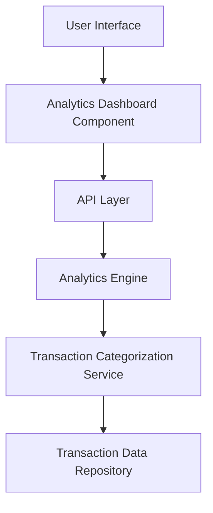

#### 1. High-Level Design

- **Summary:** This epic provides users with analytical capabilities to understand spending behavior through interactive visualizations. Users can analyze spending patterns across 9 predefined categories (Food & Dining, Fuel, Shopping, Travel, Entertainment, Utilities, Healthcare, Education, Miscellaneous), view monthly spend trends, and gain actionable insights for financial optimization.

- **Component Flow:**

- **Integration Points:** 
  - Transaction data service for retrieving historical spending data
  - Transaction categorization engine or service (may be integrated or separate)

- **Key Assumptions:** 
  - Transactions are pre-categorized or categorized on-the-fly using rule-based or ML-based categorization logic
  - Historical data retention period supports at least 12 months of trend analysis

- **NFR Highlights:** Visualizations must load within acceptable time frames even with large transaction datasets; charts and graphs must be interactive and responsive; accurate transaction categorization is required

#### 2. Validation Report

- **Requirements Coverage:** The design addresses all scope elements including interactive visualizations, category-wise analysis across 9 categories, monthly trend charts, transaction categorization, and spending pattern identification. The architecture supports data aggregation, categorization, and visualization rendering as specified. NFRs for performance, interactivity, and accuracy are addressed through dedicated analytics and categorization services.