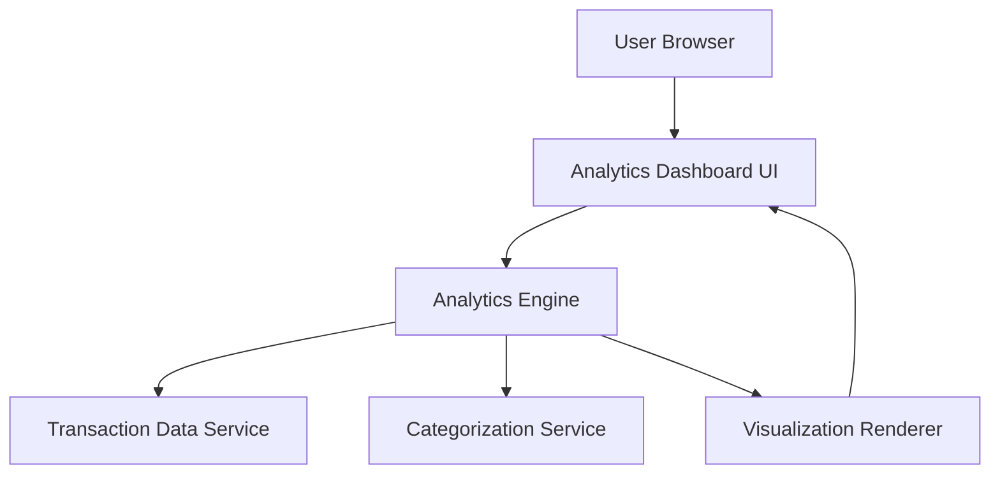

#### 1. High-Level Design

- **Summary:** This epic provides interactive analytical capabilities enabling users to understand spending behavior through visualizations. Users can analyze spending across 9 predefined categories (Food & Dining, Fuel, Shopping, Travel, Entertainment, Utilities, Healthcare, Education, Miscellaneous), view monthly trends, and identify spending patterns for financial optimization.

- **Component Flow:**

- **Integration Points:** 
  - **Upstream:** Transaction data service for retrieving historical spending data
  - **Upstream:** Transaction categorization engine/service for category assignment
  - **Downstream:** Visual analytics dashboard renders interactive charts and insights to user

- **Key Assumptions:** 
  - Transactions are pre-categorized or categorization logic is available via service; historical data for at least 12 months is accessible
  - Visualization library supports interactive, responsive charts compatible with target devices

- **NFR Highlights:** Visualizations must load within acceptable time frames with large datasets; charts must be interactive and responsive; system must accurately categorize transactions

#### 2. Validation Report

- **Requirements Coverage:** The design addresses all scope elements including interactive visualizations, category-wise analysis across 9 categories, monthly trend charts, transaction categorization, and spending pattern identification. The architecture integrates with required transaction and categorization services, and supports the NFRs for performance, interactivity, and accuracy.