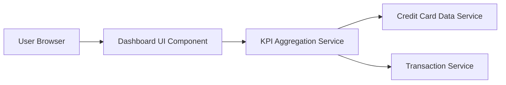

#### 1. High-Level Design

- **Summary:** This epic delivers a responsive, centralized dashboard that consolidates key performance indicators (KPIs) for the user's credit card portfolio. The dashboard displays monthly spend, total credit limit, available credit, and outstanding amounts across all cards, providing real-time visibility into financial health and enabling informed spending decisions.

- **Component Flow:**

- **Integration Points:** 
  - **Upstream:** Credit card data source/service for retrieving card balances and limits
  - **Upstream:** Transaction service for calculating monthly spend and outstanding amounts
  - **Downstream:** Dashboard UI renders aggregated KPI data to user

- **Key Assumptions:** 
  - KPI calculations are performed server-side by aggregation service; data is refreshed on dashboard load or user-triggered refresh
  - Credit card and transaction data are available via RESTful APIs with standardized JSON response format

- **NFR Highlights:** Dashboard must load within 2 seconds; support responsive design for mobile, tablet, and desktop; handle real-time data refresh for KPI updates

#### 2. Validation Report

- **Requirements Coverage:** The design covers all stated scope elements including monthly spend KPI, total credit limit aggregation, available credit calculation, outstanding amount tracking, responsive layout, and consolidated multi-card view. The component flow demonstrates integration with required data services, and the architecture supports the specified NFRs for load time and responsive design.