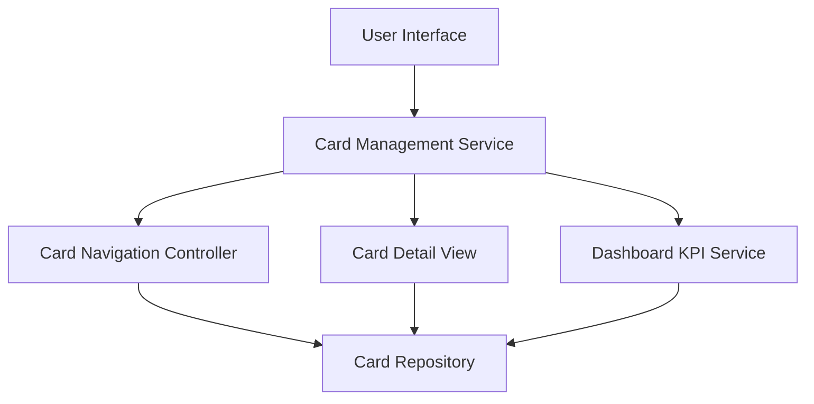

#### 1. High-Level Design

- **Summary:** This epic enables users to view and manage multiple credit cards within the dashboard ecosystem. It provides detailed information for each card including card-specific spending, limits, and balances, with a comprehensive interface for switching between cards, comparing performance, and understanding credit portfolio composition. Supports efficient multi-card management for users with up to 20 credit cards.

- **Component Flow:**

- **Integration Points:**
  - **Upstream:** Credit Card Data Repository (stores and provides card information), Dashboard KPI Service (provides aggregated metrics for comparison)
  - **Downstream:** None explicitly mentioned; card data may feed analytics and reporting features
  - **Internal:** Card Navigation Controller (manages card switching and selection), Card Detail View (displays individual card information)

- **Key Assumptions:**
  - Credit card data repository maintains consistent schema for all cards; assumes standardized data structure for card details, spending, limits, and balances.
  - Card switching and navigation occur client-side or with cached data to meet sub-500ms latency requirement; assumes efficient data retrieval and caching mechanisms.

- **NFR Highlights:** System must support viewing and managing up to 20 credit cards per user; card switching and navigation must be instantaneous with less than 500ms latency; data consistency must be maintained across all card views.

- **Data Flow:** User accesses card management interface via User Interface → Card Management Service retrieves list of user's credit cards from Card Repository → Multiple credit cards are displayed with summary information → User selects a specific card via Card Navigation Controller → Card Detail View fetches detailed information for selected card from Card Repository → Card-specific spending, limits, and balances are displayed → Dashboard KPI Service provides aggregated metrics for card comparison → User can switch between cards with sub-500ms latency → Data consistency is maintained across all card views through synchronized data access.

#### 2. Validation Report

- **Requirements Coverage:** The design comprehensively addresses the epic's scope including multiple credit card display and listing, card-wise spend analysis, individual card detail views, card selection and navigation, and card-specific balance and limit tracking. The architecture meets all NFR requirements for supporting up to 20 credit cards per user, sub-500ms card switching latency, and data consistency across all card views. Dependencies on credit card data repository and dashboard KPI service are properly integrated. Out-of-scope items (real bank integration, card payments, fund transfers, loans, payment gateway integration) are appropriately excluded from the design.