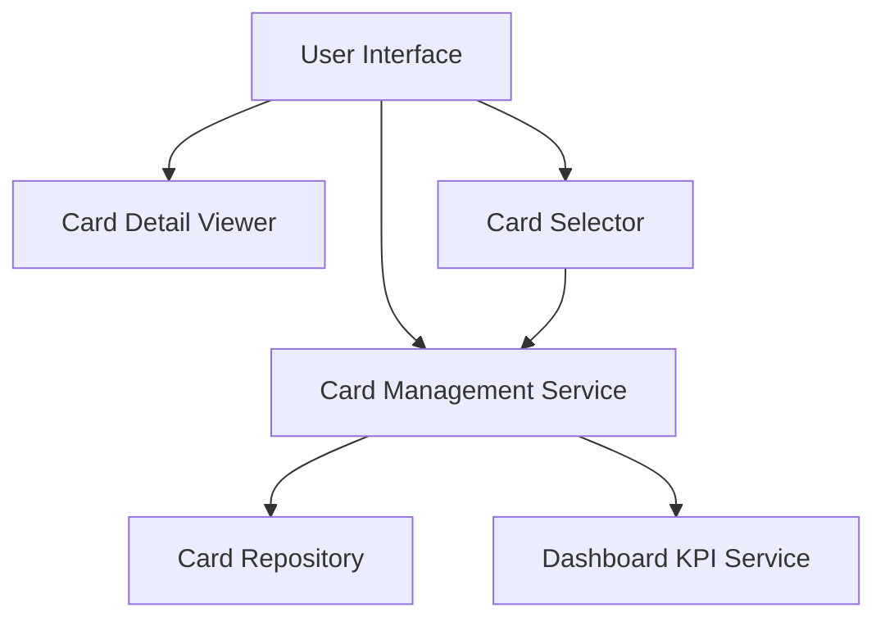

#### 1. High-Level Design

- **Summary:** This epic enables centralized viewing and management of multiple credit cards with detailed card-specific information (spending, limits, balances), card comparison capabilities, and seamless card navigation for efficient portfolio management and credit usage optimization.

- **Component Flow:**

- **Integration Points:** 
  - **Upstream:** Credit card data repository
  - **Downstream:** Dashboard KPI service for aggregated metrics

- **Key Assumptions:** 
  - Card data is stored in a normalized repository with efficient indexing to support sub-500ms card switching
  - Data consistency across card views is maintained through transactional data access or eventual consistency mechanisms

- **NFR Highlights:** System must support viewing and managing up to 20 credit cards per user; card switching and navigation must be instantaneous with less than 500ms latency; data consistency must be maintained across all card views.

- **Data Flow:** User Interface loads with Card Selector → User selects a specific card → Card Management Service retrieves card details from Card Repository → Card Detail Viewer displays card-specific spending, limits, and balances → Dashboard KPI Service provides aggregated metrics for comparison → User can switch between cards (sub-500ms latency) → Card Management Service ensures data consistency across all card views → User compares card performance and optimizes credit usage across portfolio of up to 20 cards.

#### 2. Validation Report

- **Requirements Coverage:** The design comprehensively covers all scope items including multiple credit card display and listing, card-wise spend analysis, individual card detail views, card selection and navigation, and card-specific balance and limit tracking. All NFRs are addressed: support for up to 20 cards per user through scalable data structures, sub-500ms card switching through optimized data retrieval and caching, and data consistency through transactional or eventual consistency mechanisms. Dependencies on credit card data repository and dashboard KPI service are properly integrated.