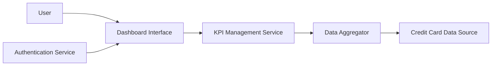

#### 1. High-Level Design

- **Summary:** This epic creates a modern, responsive central dashboard providing unified visibility into all credit cards with real-time KPIs (monthly spend, total credit limit, available credit, outstanding amounts) for quick financial position assessment and informed credit usage decisions.

- **Component Flow:**

- **Integration Points:** 
  - **Upstream:** Credit card data source or mock data service, User authentication service for secure access
  - **Downstream:** None explicitly mentioned

- **Key Assumptions:** 
  - KPI calculations are performed server-side by the Data Aggregator to ensure consistent and accurate metrics
  - Real-time or near real-time data refresh is achieved through periodic API polling or WebSocket connections

- **NFR Highlights:** Dashboard must load within 2 seconds; system must support responsive design across desktop, tablet, and mobile devices; data refresh must occur in real-time or near real-time; UI must be accessible and comply with WCAG 2.1 standards.

- **Data Flow:** User authenticates via Authentication Service → Dashboard Interface loads → KPI Management Service requests aggregated data → Data Aggregator retrieves and processes data from Credit Card Data Source → Calculated KPIs (monthly spend, total credit limit, available credit, outstanding amounts) returned → Dashboard Interface displays KPIs in responsive, WCAG 2.1-compliant layout → Real-time/near real-time refresh updates KPI values → User views consolidated credit card portfolio and makes informed financial decisions.

#### 2. Validation Report

- **Requirements Coverage:** The design fully covers the epic scope including dashboard interface design and development, monthly spend KPI display, total credit limit aggregation, available credit calculation and display, outstanding amount tracking, multiple credit card view integration, and responsive layout implementation. All NFRs are addressed: 2-second load time through optimized data retrieval and caching, responsive design across devices through adaptive UI framework, real-time/near real-time data refresh through polling or push mechanisms, and WCAG 2.1 accessibility compliance through accessible UI components. Dependencies on credit card data source and authentication service are properly integrated.