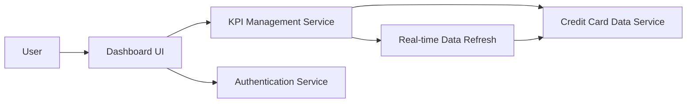

#### 1. High-Level Design

- **Summary:** This epic creates a modern, responsive dashboard serving as the central hub for credit card management. It provides users with a consolidated view of all credit cards and key performance indicators (monthly spend, total credit limit, available credit, outstanding amounts), enabling instant visibility into credit card portfolio and real-time financial position assessment.

- **Component Flow:**

- **Integration Points:**
  - **Upstream:** Credit Card Data Source or Mock Data Service (provides card and financial data), User Authentication Service (secures dashboard access)
  - **Downstream:** None explicitly mentioned; KPI data may be consumed by other analytics or reporting modules
  - **Internal:** KPI Management Service (calculates and manages financial metrics), Real-time Data Refresh (updates metrics in near real-time)

- **Key Assumptions:**
  - Credit card data includes all necessary attributes for KPI calculation (limits, balances, transaction history); assumes data completeness and reliability.
  - Real-time or near real-time refresh is supported by the data source with acceptable latency; specific refresh interval not defined in the epic.

- **NFR Highlights:** Dashboard must load within 2 seconds; system must support responsive design across desktop, tablet, and mobile devices; data refresh must occur in real-time or near real-time; UI must be accessible and comply with WCAG 2.1 standards.

- **Data Flow:** User authenticates via Authentication Service → User accesses dashboard through Dashboard UI → KPI Management Service retrieves credit card data from Credit Card Data Service → Service calculates monthly spend, total credit limit, available credit, and outstanding amounts for all cards → Aggregated KPIs and individual card details are displayed in responsive Dashboard UI → Real-time Data Refresh monitors for data changes and triggers KPI recalculation → Updated metrics are pushed to Dashboard UI for immediate display.

#### 2. Validation Report

- **Requirements Coverage:** The design fully addresses the epic's scope including dashboard interface design and development, monthly spend KPI display, total credit limit aggregation, available credit calculation and display, outstanding amount tracking, multiple credit card view integration, and responsive layout implementation. The architecture meets all NFR requirements for 2-second load time, responsive design across all devices, real-time/near real-time data refresh, and WCAG 2.1 accessibility compliance. Dependencies on credit card data source and authentication service are properly integrated. Out-of-scope items (real bank integration, card payments, fund transfers, loans, payment gateway integration) are correctly excluded from the design.