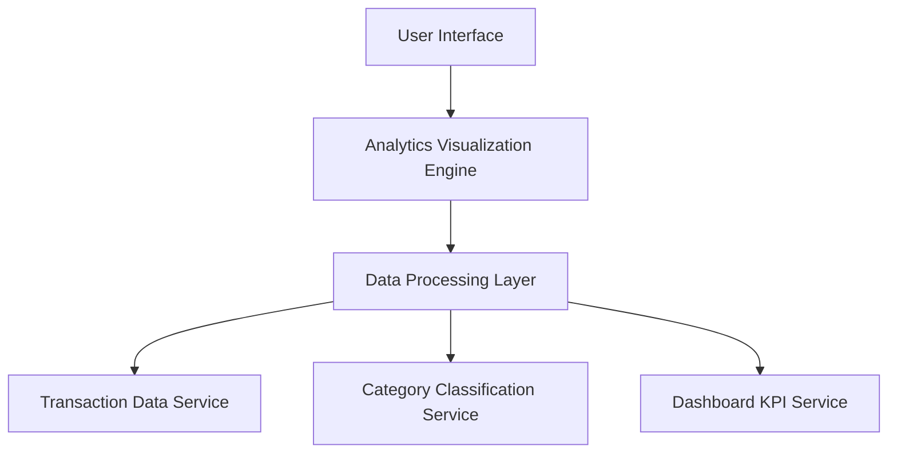

#### 1. High-Level Design

- **Summary:** This epic delivers interactive visualizations and analytics to help users understand spending patterns and financial behavior. It provides monthly spend trend charts, card-wise spending breakdowns, and category-wise analysis across nine predefined categories, enabling users to identify spending patterns and make data-driven financial decisions.

- **Component Flow:**

- **Integration Points:**
  - **Upstream:** Transaction Data Service (provides spending data for aggregation), Category Classification Engine or Service (categorizes transactions into nine predefined categories), Dashboard KPI Service (provides consolidated metrics)
  - **Downstream:** None explicitly mentioned; analytics insights may inform other financial planning features
  - **Internal:** Analytics Visualization Engine (renders interactive charts and graphs), Data Processing Layer (aggregates and processes spending data)

- **Key Assumptions:**
  - Category classification is handled by an external service or predefined logic; assumes consistent and accurate categorization across all transactions.
  - Monthly spend trends are calculated based on transaction timestamps; assumes data availability for historical trend analysis (timeframe not specified).

- **NFR Highlights:** Analytics visualizations must render within 1 second; support interactive filtering and drill-down capabilities; charts must be responsive and accessible across all device types.

- **NFR Highlights:** Analytics visualizations must render within 1 second; support interactive filtering and drill-down capabilities; charts must be responsive and accessible across all device types.

- **Data Flow:** User accesses analytics dashboard via User Interface → Analytics Visualization Engine requests processed data from Data Processing Layer → Data Processing Layer retrieves transaction data from Transaction Data Service → Category Classification Service categorizes transactions into nine spending categories → Data Processing Layer aggregates spending by month, card, and category → Dashboard KPI Service provides consolidated metrics for context → Processed data is returned to Analytics Visualization Engine → Interactive charts (monthly trends, card-wise breakdown, category-wise spending) are rendered in User Interface → User interacts with visualizations (filtering, drill-down) to explore spending patterns.

#### 2. Validation Report

- **Requirements Coverage:** The design comprehensively covers the epic's scope including monthly spend trend visualization, card-wise spend analysis, category-wise spending breakdown, interactive charts and graphs, spending pattern identification, nine-category classification system, and visual analytics dashboard. The architecture meets all NFR requirements for 1-second rendering time, interactive filtering and drill-down capabilities, and responsive design across all device types. All stated dependencies (transaction data service, category classification engine, dashboard KPI service) are properly integrated. Out-of-scope items (real bank integration, predictive analytics, budget recommendations, automated alerts, third-party financial tool integrations, loans analysis) are appropriately excluded.