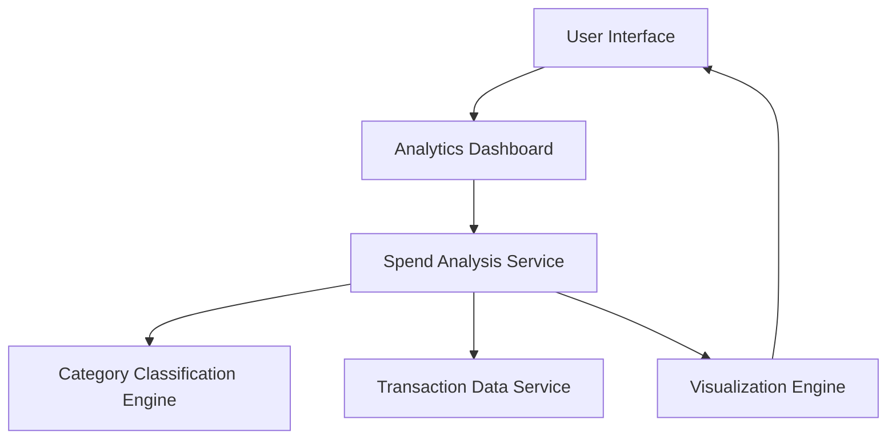

#### 1. High-Level Design

- **Summary:** This epic delivers interactive visualizations and analytics for understanding spending patterns through monthly spend trend charts, card-wise spending breakdowns, and category-wise analysis across nine predefined categories, enabling data-driven financial optimization.

- **Component Flow:**

- **Integration Points:** 
  - **Upstream:** Transaction data service for aggregating spending data, Category classification engine or service, Dashboard KPI service for consolidated metrics
  - **Downstream:** None explicitly mentioned

- **Key Assumptions:** 
  - Category classification is either pre-assigned to transactions or performed by the Category Classification Engine using rule-based or ML-based logic
  - Monthly trend data is aggregated and cached to support 1-second visualization render time

- **NFR Highlights:** Analytics visualizations must render within 1 second; support interactive filtering and drill-down capabilities; charts must be responsive and accessible across all device types.

- **Data Flow:** User accesses Analytics Dashboard → Spend Analysis Service requests transaction data from Transaction Data Service → Category Classification Engine categorizes transactions into nine spending categories → Aggregated spending data by month, card, and category prepared → Visualization Engine renders interactive charts (monthly trends, card-wise breakdown, category-wise spending) → User Interface displays responsive visualizations → User interacts with charts through filtering and drill-down for deeper insights.

#### 2. Validation Report

- **Requirements Coverage:** The design comprehensively covers all scope elements including monthly spend trend visualization, card-wise spend analysis, category-wise spending breakdown, interactive charts and graphs, spending pattern identification, nine-category classification system, and visual analytics dashboard. All NFRs are addressed: 1-second render time through optimized visualization engine, interactive filtering and drill-down through dedicated UI controls, and responsive/accessible charts across devices. Dependencies on transaction data service, category classification engine, and dashboard KPI service are properly integrated.