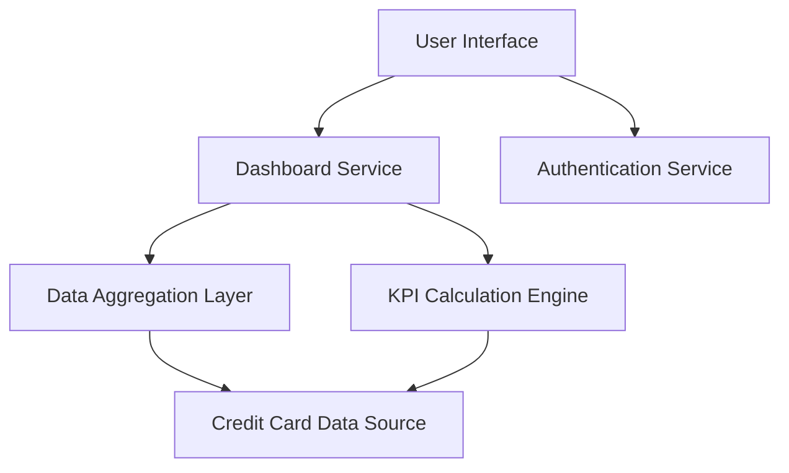

#### 1. High-Level Design

- **Summary:** This epic creates a consolidated dashboard interface for managing and monitoring multiple credit cards. Users can view critical financial metrics (monthly spend, total credit limit, available credit, outstanding amounts) across all cards, providing a comprehensive overview of credit utilization and financial position through a modern, responsive interface.

- **Component Flow:**

- **Integration Points:**
  - **Upstream:** Credit Card Data Source or Mock Data Service (provides card details and financial data), User Authentication Service (secures dashboard access)
  - **Downstream:** None explicitly mentioned; KPI data may feed other analytics or reporting modules
  - **Internal:** KPI Calculation Engine (computes aggregated financial metrics), Data Aggregation Layer (consolidates multi-card data)

- **Key Assumptions:**
  - Credit card data includes necessary fields for KPI calculation (credit limit, current balance, monthly transactions); assumes data completeness and accuracy.
  - Real-time or near real-time data refresh is supported by the data source; refresh frequency and mechanism are not specified in the epic.

- **NFR Highlights:** Dashboard must be responsive across desktop, tablet, and mobile devices; page load time must be under 2 seconds; support real-time data refresh for KPI metrics.

- **Data Flow:** User authenticates and accesses dashboard via User Interface → Dashboard Service requests data from Credit Card Data Source through Data Aggregation Layer → Data Aggregation Layer consolidates data from multiple credit cards → KPI Calculation Engine computes monthly spend, total credit limit, available credit, and outstanding amounts → Calculated KPIs are returned to Dashboard Service → Dashboard displays aggregated metrics and individual card information in responsive layout → Real-time refresh updates KPI values as data changes.

#### 2. Validation Report

- **Requirements Coverage:** The design fully addresses the epic's scope including dashboard interface, multiple credit card display, monthly spend tracking, total credit limit aggregation, available credit calculation, outstanding amount tracking, responsive layout design, and KPI visualization. The architecture meets all NFR requirements for responsive design across devices, sub-2-second page load time, and real-time data refresh. Dependencies on credit card data source and authentication service are properly integrated. Out-of-scope items (real bank integration, card payments, fund transfers, loans, payment gateway integration) are correctly excluded from the design.