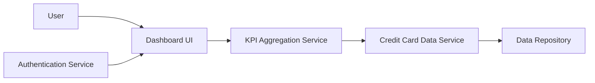

#### 1. High-Level Design

- **Summary:** This epic delivers a consolidated dashboard interface for managing multiple credit cards with real-time KPI tracking including monthly spend, total credit limit, available credit, and outstanding amounts, providing users with comprehensive financial position visibility across all cards.

- **Component Flow:**

- **Integration Points:** 
  - **Upstream:** Credit card data source or mock data service, User authentication service for secure access
  - **Downstream:** None explicitly mentioned

- **Key Assumptions:** 
  - KPI calculations (available credit, outstanding amounts) are computed in real-time or near real-time from credit card data
  - Dashboard supports responsive design through adaptive UI components that adjust to different screen sizes

- **NFR Highlights:** Dashboard must be responsive across desktop, tablet, and mobile devices; page load time must be under 2 seconds; support real-time data refresh for KPI metrics.

- **Data Flow:** User authenticates via Authentication Service → Dashboard UI loads → KPI Aggregation Service requests data from Credit Card Data Service → Credit Card Data Service retrieves card information from Data Repository → Aggregated KPIs calculated (monthly spend, total credit limit, available credit, outstanding amounts) → KPIs and card portfolio displayed in responsive Dashboard UI → Real-time/near real-time refresh updates KPI values → User views consolidated financial position across all credit cards.

#### 2. Validation Report

- **Requirements Coverage:** The design fully addresses the epic scope including dashboard interface, multiple credit card display, monthly spend tracking, total credit limit aggregation, available credit calculation, outstanding amount tracking, responsive layout design, and KPI visualization. All NFRs are covered: responsive design across devices through adaptive UI, sub-2-second page load through optimized data retrieval, and real-time data refresh through periodic polling or push mechanisms. Dependencies on credit card data source and authentication service are properly integrated.