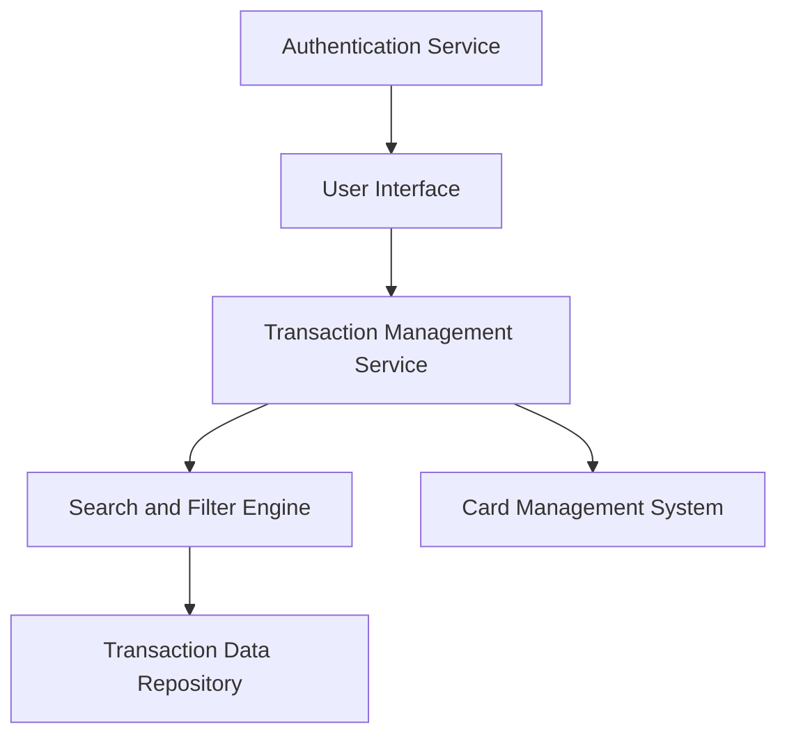

#### 1. High-Level Design

- **Summary:** This epic provides comprehensive transaction tracking and monitoring capabilities across all credit cards, enabling users to view, search, filter, and access detailed transaction information for complete spending visibility and financial control.

- **Component Flow:**

- **Integration Points:** 
  - **Upstream:** Credit card transaction data source, Card management system (for linking transactions to specific cards), User authentication and authorization service
  - **Downstream:** None explicitly mentioned

- **Key Assumptions:** 
  - Transaction data is stored in a centralized repository accessible by the Transaction Management Service
  - Search and filtering operations are optimized with appropriate indexing to meet the 500ms retrieval requirement

- **NFR Highlights:** System must handle up to 10,000 transactions per user efficiently; transaction data retrieval must complete within 500ms; secure data transmission and storage for sensitive transaction information.

- **Data Flow:** User authenticates via Authentication Service → User Interface requests transaction data → Transaction Management Service queries Transaction Data Repository with filters/search criteria → Search and Filter Engine processes query parameters → Filtered transaction list retrieved (linked to specific cards via Card Management System) → Transaction details displayed in User Interface → User can view detailed information for each transaction including amount, merchant, date, category, and associated card.

#### 2. Validation Report

- **Requirements Coverage:** The design comprehensively covers all scope items including transaction listing, transaction details display, multi-card transaction view, transaction filtering, search functionality, and transaction history access. All NFRs are addressed: 10K transaction handling through efficient data repository design, 500ms retrieval through optimized querying, and secure data transmission/storage through dedicated security measures. Dependencies on transaction data source, card management system, and authentication service are properly integrated.