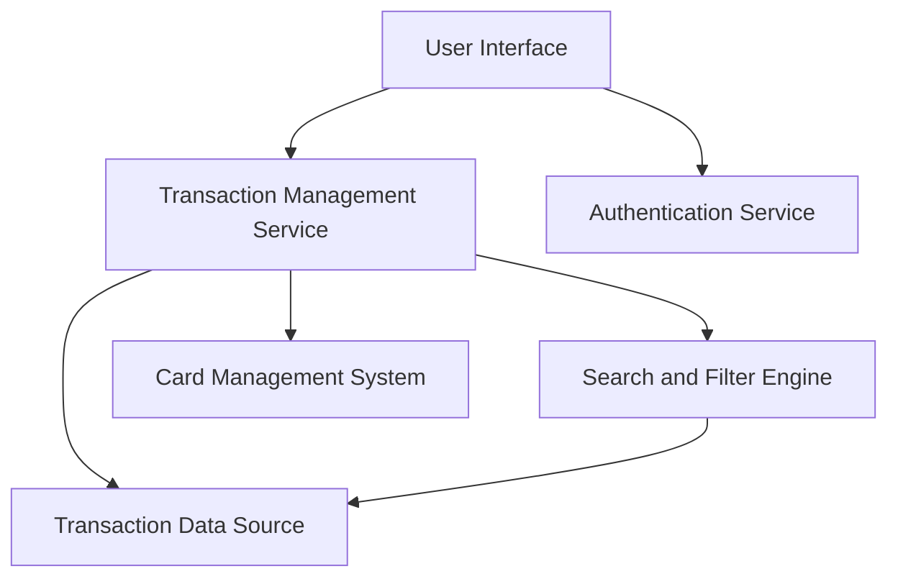

#### 1. High-Level Design

- **Summary:** This epic delivers comprehensive transaction tracking and monitoring capabilities across multiple credit cards. Users can view, search, filter, and access detailed transaction information to gain complete visibility into credit utilization and spending behavior, supporting proactive financial management.

- **Component Flow:**

- **Integration Points:**
  - **Upstream:** Credit Card Transaction Data Source (provides transaction records), Card Management System (links transactions to specific cards), User Authentication and Authorization Service (secures access)
  - **Downstream:** None explicitly mentioned; transaction data may feed analytics/reporting systems
  - **Internal:** Search and Filter Engine (enables transaction querying and filtering)

- **Key Assumptions:**
  - Transaction data is retrieved from a centralized data source with standardized schema; assumes data consistency across multiple credit cards.
  - Search and filter operations support common criteria (date range, amount, merchant, category); specific filter attributes are not detailed in the epic.

- **NFR Highlights:** System must handle and display up to 10,000 transactions per user efficiently; transaction data retrieval must complete within 500ms; secure data transmission and storage for sensitive transaction information.

- **Data Flow:** User authenticates via Authentication Service → User requests transaction list through User Interface → Transaction Management Service retrieves transactions from Transaction Data Source → Card Management System links transactions to specific cards → User applies search/filter criteria via Search and Filter Engine → Filtered transaction results are returned and displayed → User selects a transaction to view detailed information → Transaction details are fetched and displayed in the User Interface.

#### 2. Validation Report

- **Requirements Coverage:** The design comprehensively addresses the epic's scope including transaction listing, transaction details display, multi-card transaction view, transaction filtering, search functionality, and transaction history access. The architecture supports the NFR requirements for handling 10,000 transactions per user, 500ms retrieval time, and secure data handling. All stated dependencies (transaction data source, card management system, authentication service) are integrated into the design. Out-of-scope items (real bank integration, payments, fund transfers, payment gateway, transaction disputes, transaction editing/deletion) are appropriately excluded.