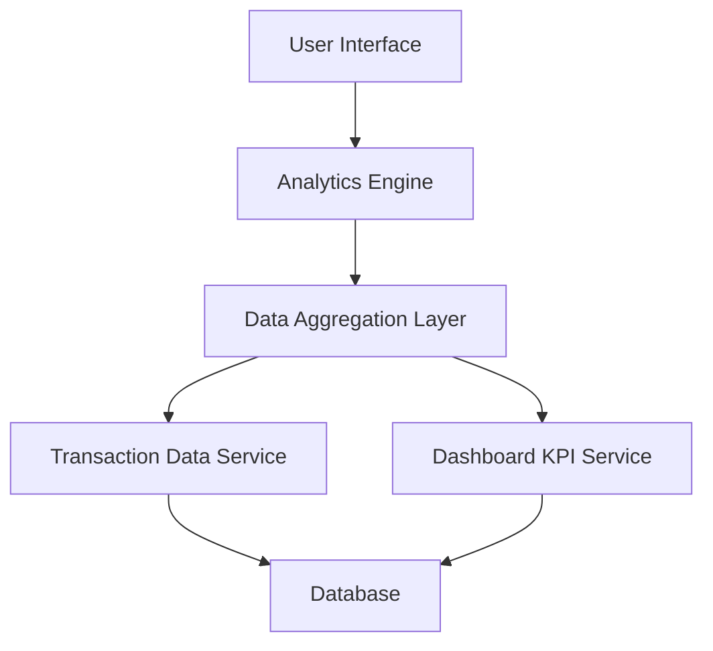

#### 1. High-Level Design

- **Summary:** This epic provides users with comprehensive spending analytics through interactive visualizations across nine predefined spending categories (Food & Dining, Fuel, Shopping, Travel, Entertainment, Utilities, Healthcare, Education, Miscellaneous). It includes monthly trend analysis, transaction drill-down capabilities, and pattern identification to support data-driven financial decision-making.

- **Component Flow:**

- **Integration Points:**
  - **Upstream:** Transaction Data Service (provides raw transaction data for analysis)
  - **Downstream:** Dashboard KPI Service (receives aggregated metrics for consolidated dashboard views)
  - **Internal:** Analytics Engine (processes and aggregates transaction data for visualization)

- **Key Assumptions:**
  - Transaction categorization into nine predefined categories is performed by an upstream service or classification engine; category assignment logic is assumed to be accurate and consistent.
  - Monthly spend trends are calculated based on transaction date fields; assumes transaction timestamps are reliable and timezone-normalized.

- **NFR Highlights:** Analytics visualizations must render within 3 seconds; system must handle up to 10,000 transactions per user; data aggregation must complete within 5 seconds; charts must be interactive and responsive across all device types.

- **Data Flow:** User requests spending analytics → Analytics Engine retrieves transaction data from Transaction Data Service → Data Aggregation Layer processes and categorizes transactions into nine spending categories → Aggregated data is calculated for monthly trends and category-wise breakdowns → Visualizations (charts/graphs) are rendered in the User Interface → User can drill down into specific categories or time periods to view detailed transactions.

#### 2. Validation Report

- **Requirements Coverage:** The design fully covers the epic's stated scope including category-wise spending visualization, monthly spend trends, interactive charts, transaction listing, and spending pattern identification. All nine spending categories are supported. The architecture accommodates the NFRs for rendering performance (3 seconds), transaction volume (10,000 per user), and data aggregation speed (5 seconds). Integration with Transaction Data Service and Dashboard KPI Service aligns with stated dependencies. Out-of-scope items (real bank integration, payments, fund transfers, loans, payment gateway, third-party tools) are appropriately excluded from the design.