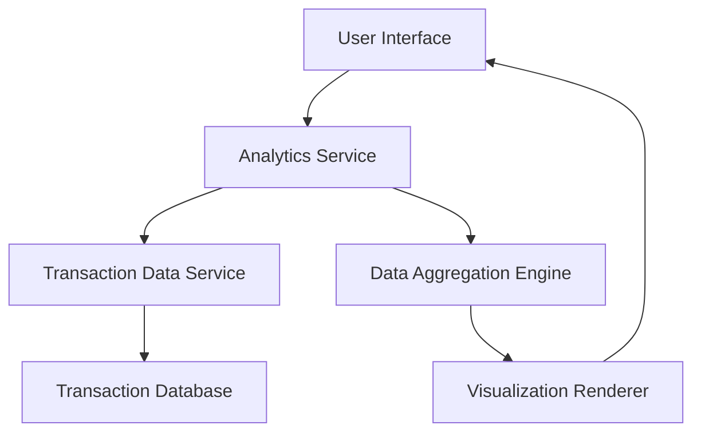

#### 1. High-Level Design

- **Summary:** This epic delivers comprehensive analytics capabilities enabling users to visualize spending patterns across nine predefined categories (Food & Dining, Fuel, Shopping, Travel, Entertainment, Utilities, Healthcare, Education, Miscellaneous), analyze monthly spend trends, and drill down into transaction details for data-driven financial decision-making.

- **Component Flow:**

- **Integration Points:** 
  - **Upstream:** Transaction data service (provides raw transaction data), Analytics engine for data aggregation and calculation
  - **Downstream:** Dashboard KPI service for consolidated metrics

- **Key Assumptions:** 
  - Transaction categorization is pre-classified in the data source or handled by a separate categorization service
  - Monthly aggregation is calculated on-demand or pre-computed and cached for performance

- **NFR Highlights:** Analytics visualizations must render within 3 seconds; system must handle up to 10,000 transactions per user; charts must be interactive and responsive; data aggregation must complete within 5 seconds.

- **Data Flow:** User requests spending analytics → Analytics Service queries Transaction Data Service → Raw transaction data retrieved from Transaction Database → Data Aggregation Engine processes and categorizes transactions into nine spending categories → Aggregated data passed to Visualization Renderer → Interactive charts and graphs rendered in User Interface → User can drill down into specific transactions or time periods for detailed insights.

#### 2. Validation Report

- **Requirements Coverage:** The design fully covers the epic's stated scope including category-wise spending visualization, monthly spend trends analysis, interactive charts, transaction listing, spending pattern identification across nine categories, and time-based analysis. All NFRs (3-second render time, 10K transaction handling, responsive charts, 5-second aggregation) are addressed through dedicated components (Analytics Service, Data Aggregation Engine, Visualization Renderer).