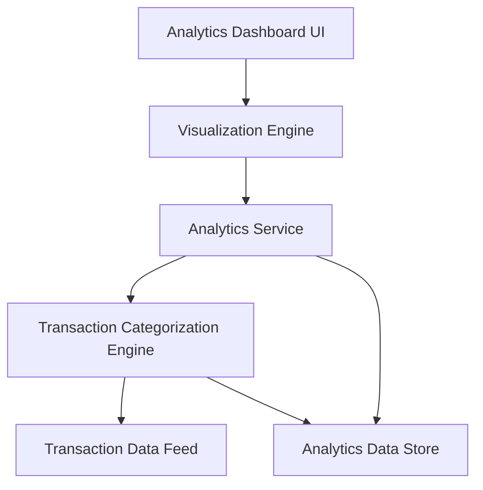

#### 1. High-Level Design

- **Summary:** This epic provides interactive visualizations and analytics for users to understand spending patterns through category-wise breakdowns and monthly trends. The system categorizes transactions across 9 predefined categories (Food & Dining, Fuel, Shopping, Travel, Entertainment, Utilities, Healthcare, Education, Miscellaneous) and delivers actionable insights through interactive charts with drill-down capabilities, handling at least 12 months of transaction history.

- **Component Flow:**

- **Integration Points:** 
  - **Upstream:** Transaction data feed from credit card systems for raw transaction data
  - **External:** Transaction categorization engine/service for automated category assignment
  - **External:** Visualization libraries (e.g., D3.js, Chart.js) for chart rendering
  - **Internal:** Analytics Data Store for processed transaction and category data

- **Key Assumptions:** 
  - Transactions arrive with sufficient metadata (merchant name, MCC codes) to enable accurate categorization
  - The 9 predefined categories cover the majority of user transactions; miscellaneous category handles edge cases

- **NFR Highlights:** Visualizations must render within 1.5 seconds; support 12+ months of transaction history; interactive charts with drill-down; handle 1000+ transactions per card

- **Data Flow:** User accesses analytics dashboard → Analytics Dashboard UI requests data from Analytics Service → Service queries Analytics Data Store for historical transaction data → If new transactions exist, Transaction Categorization Engine processes raw data from Transaction Data Feed → Transactions assigned to predefined categories → Categorized data stored in Analytics Data Store → Analytics Service aggregates data by category and time period → Visualization Engine generates interactive charts (category-wise breakdown, monthly trends) → Charts rendered in UI within 1.5 seconds → User interacts with charts (filtering, drill-down) → Service responds with detailed transaction views

#### 2. Validation Report

- **Requirements Coverage:** The design fully addresses all requirements in the epic scope including category-wise spending visualization, monthly spend trends analysis, interactive charts and graphs, transaction categorization, spending pattern identification, and multi-category filtering. The architecture supports all NFRs: the Visualization Engine and Analytics Service are designed to meet the 1.5-second rendering requirement; the Analytics Data Store is structured to handle 12+ months of history and 1000+ transactions per card; interactive and drill-down capabilities are provided through the Visualization Engine. All dependencies are properly integrated including transaction data feeds, categorization engine/service, and visualization libraries. The 9 predefined categories from the epic are explicitly supported by the Transaction Categorization Engine.