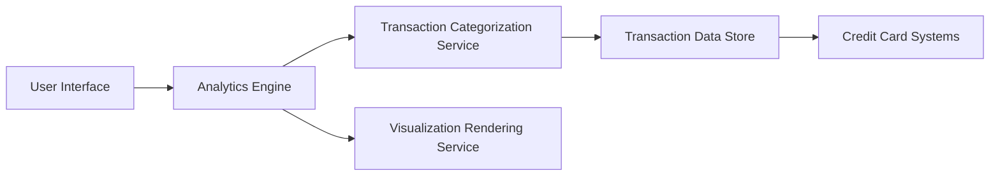

#### 1. High-Level Design

- **Summary:** This epic delivers interactive visualizations and analytics capabilities enabling users to understand spending patterns through category-wise breakdowns (Food & Dining, Fuel, Shopping, Travel, Entertainment, Utilities, Healthcare, Education, Miscellaneous) and monthly spend trends with actionable insights for financial decision-making.

- **Component Flow:**

- **Integration Points:**
  - **Upstream:** Credit Card Systems (transaction data feed source)
  - **Downstream:** Transaction Categorization Engine/Service, Visualization Libraries for chart rendering

- **Key Assumptions:**
  - Transactions are categorized automatically using predefined rules or ML models into the nine categories.
  - Analytics visualizations assume 12-month historical data is pre-aggregated for performance to meet 1.5-second rendering requirement.

- **NFR Highlights:** Analytics visualizations must render within 1.5 seconds; system must handle transaction history of at least 12 months; charts must be interactive and support drill-down capabilities; support for at least 1000 transactions per card.

- **Data Flow:** User requests spending analytics → Analytics Engine queries Transaction Data Store for historical data (12 months) → Transaction Categorization Service provides category mappings → Analytics Engine performs aggregations and trend calculations → Visualization Rendering Service generates interactive charts → User interacts with multi-category filtering and drill-down capabilities for deeper insights into spending patterns.

#### 2. Validation Report

- **Requirements Coverage:** The design comprehensively addresses all scope elements including category-wise spending visualization, monthly spend trends analysis, interactive charts and graphs, transaction categorization, spending pattern identification, and multi-category filtering. All NFRs are architecturally supported: 1.5-second rendering through pre-aggregated data and optimized queries, 12-month transaction history handling through dedicated data store, interactive drill-down through modern visualization library, and support for 1000+ transactions per card through scalable data architecture. All dependencies (transaction data feed from credit card systems, transaction categorization engine/service, visualization libraries) are explicitly integrated in the component architecture.