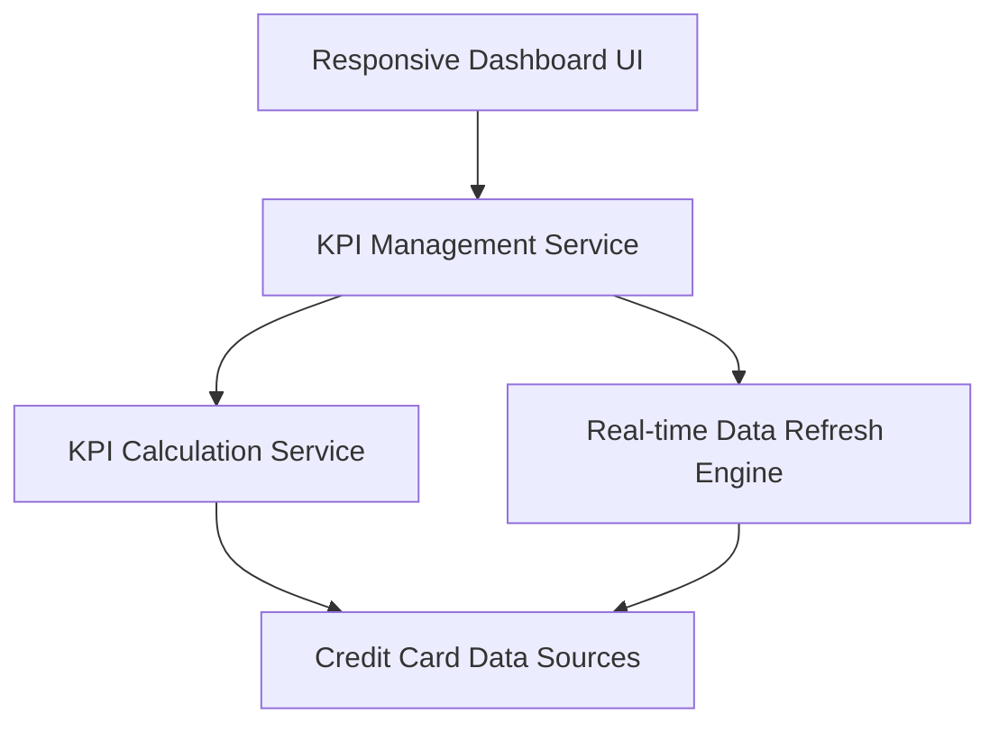

#### 1. High-Level Design

- **Summary:** This epic enables users to access a consolidated dashboard displaying key performance indicators for their credit card portfolio, including monthly spend, total credit limit, available credit, and outstanding amounts across all cards from a single responsive interface with real-time visibility.

- **Component Flow:**

- **Integration Points:**
  - **Upstream:** Credit Card Data Sources (for retrieving card balances, limits, and transaction data)
  - **Downstream:** KPI Calculation Service, Real-time Data Refresh Engine

- **Key Assumptions:**
  - KPI metrics are pre-calculated and cached with periodic refresh to meet 2-second load time requirement.
  - Responsive design assumes modern web framework with adaptive layouts for desktop, tablet, and mobile.

- **NFR Highlights:** Dashboard must load within 2 seconds; system must support responsive design across desktop, tablet, and mobile devices; real-time data refresh capability for KPI metrics.

- **Data Flow:** User accesses dashboard → Responsive Dashboard UI loads → KPI Management Service requests metrics from KPI Calculation Service → KPI Calculation Service retrieves data from Credit Card Data Sources → Calculations performed for monthly spend, total credit limit, available credit, outstanding amounts → Real-time Data Refresh Engine ensures latest data → Consolidated KPIs displayed on responsive interface with automatic refresh capability.

#### 2. Validation Report

- **Requirements Coverage:** The design fully covers all scope elements including dashboard KPIs display, monthly spend tracking, total credit limit aggregation, available credit calculation, outstanding amount monitoring, and responsive layout implementation. All NFRs are architecturally supported: 2-second load time through pre-calculated KPIs and caching, responsive design through adaptive UI framework, and real-time data refresh through dedicated refresh engine. The dependency on credit card data sources for retrieving card balances, limits, and transaction data is explicitly addressed in the component flow.