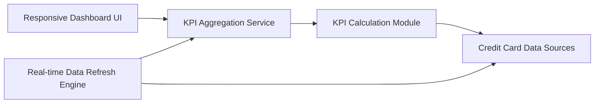

#### 1. High-Level Design

- **Summary:** This epic delivers a consolidated dashboard displaying key performance indicators (KPIs) for the user's credit card portfolio. The dashboard provides real-time visibility into monthly spend, total credit limit, available credit, and outstanding amounts across all cards through a responsive, modern interface that loads within 2 seconds.

- **Component Flow:**

- **Integration Points:** 
  - **Upstream:** Credit card data sources for retrieving card balances, limits, and transaction data
  - **Internal:** Real-time Data Refresh Engine for KPI metric updates
  - **Internal:** KPI Calculation Module for computing aggregated metrics

- **Key Assumptions:** 
  - Credit card data sources provide APIs with response times under 1 second to meet 2-second dashboard load requirement
  - KPI calculations (available credit, outstanding amounts) follow standard financial formulas

- **NFR Highlights:** Dashboard must load within 2 seconds; responsive design across desktop, tablet, and mobile; real-time data refresh capability for KPI metrics

- **Data Flow:** User accesses dashboard → Dashboard UI requests KPIs from KPI Aggregation Service → Service triggers KPI Calculation Module → Module queries Credit Card Data Sources for balances, limits, and transactions → Calculations performed (monthly spend, total limit, available credit, outstanding) → Aggregated KPIs returned to UI → Dashboard renders responsive layout with metrics → Real-time Data Refresh Engine periodically polls data sources → Updated KPIs pushed to dashboard

#### 2. Validation Report

- **Requirements Coverage:** The design comprehensively addresses all stated requirements including dashboard KPI display, monthly spend tracking, total credit limit aggregation, available credit calculation, outstanding amount monitoring, and responsive layout implementation. The architecture supports the 2-second load time NFR through the KPI Aggregation Service and efficient data retrieval patterns. The Real-time Data Refresh Engine addresses the real-time refresh capability requirement. Responsive design is explicitly included in the Dashboard UI component. All dependencies on credit card data sources are properly integrated.