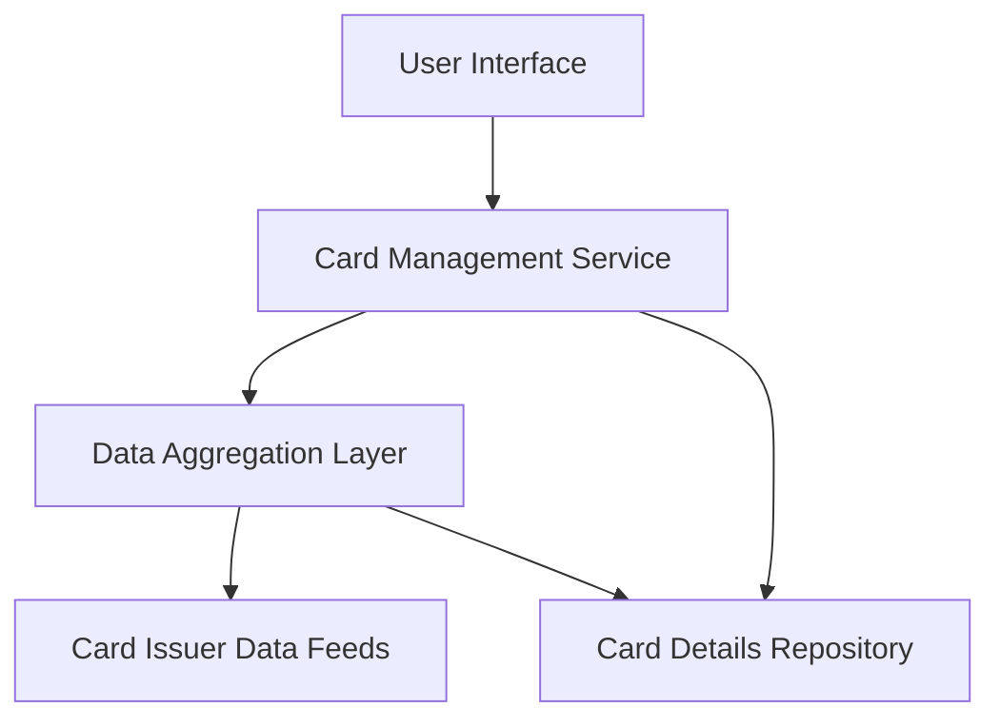

#### 1. High-Level Design

- **Summary:** This epic provides a unified interface for users to view and manage multiple credit cards simultaneously. Users can access card-specific details, perform card-wise spend analysis, and navigate seamlessly between cards. The system consolidates information from multiple card sources into a single view, displaying card status, limits, and usage patterns.

- **Component Flow:**

- **Integration Points:** 
  - **Upstream:** Credit card data aggregation services for retrieving multi-source card information
  - **Downstream:** Card issuer data feeds for real-time card status and details
  - **Internal:** Card Details Repository for storing consolidated card data

- **Key Assumptions:** 
  - Card data will be provided in a standardized format by the aggregation service
  - User authentication and card ownership verification are handled by upstream identity services

- **NFR Highlights:** System must support at least 10 cards per user with card switching latency under 100ms; data consistency across all card views required

- **Data Flow:** User requests card list → Card Management Service queries Data Aggregation Layer → Aggregation Layer fetches from Card Issuer Data Feeds and Card Details Repository → Consolidated card data returned to UI → User selects specific card → Service retrieves detailed card information → Card-wise spend analysis and status displayed to user

#### 2. Validation Report

- **Requirements Coverage:** The design fully covers the epic's scope including multiple credit card display, card-wise spend analysis, individual card details view, card selection/navigation, and card status monitoring. The component architecture supports the NFR requirements for supporting 10+ cards with sub-100ms switching latency through the Data Aggregation Layer and Card Details Repository. All stated dependencies on card data aggregation services and card issuer data feeds are addressed in the integration points.