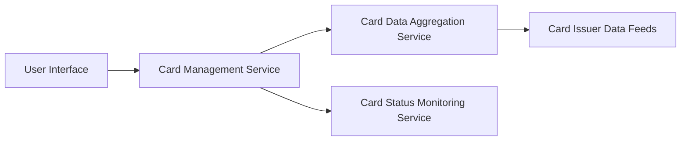

#### 1. High-Level Design

- **Summary:** This epic provides users with the ability to view and manage multiple credit cards within a single consolidated interface, supporting card-specific details, card-wise spend analysis, seamless navigation between cards, and comprehensive card status monitoring.

- **Component Flow:**

- **Integration Points:**
  - **Upstream:** Card Issuer Data Feeds (for retrieving information from multiple card sources)
  - **Downstream:** Credit Card Data Aggregation Services

- **Key Assumptions:**
  - Card data is aggregated from multiple card issuer feeds with assumed standardized data format for consistency.
  - Card switching latency under 100ms assumes client-side caching of recently viewed cards.

- **NFR Highlights:** System must support display of at least 10 credit cards per user; card switching and navigation must be instantaneous with less than 100ms latency; data consistency across all card views.

- **Data Flow:** User requests card list → Card Management Service retrieves cards from Card Data Aggregation Service → Card Data Aggregation Service fetches data from Card Issuer Data Feeds → Card Status Monitoring Service provides real-time status updates → Individual card details and spend analysis displayed → User navigates between cards with sub-100ms response time through optimized caching.

#### 2. Validation Report

- **Requirements Coverage:** The design addresses all scope elements including multiple credit card display, card-wise spend analysis, individual card details view, card selection and navigation, and card status monitoring. All NFRs are architecturally supported: 10 cards per user through scalable data structures, sub-100ms card switching through client-side caching and optimized service calls, and data consistency through centralized Card Data Aggregation Service. Dependencies on credit card data aggregation services and card issuer data feeds are explicitly integrated in the component architecture.