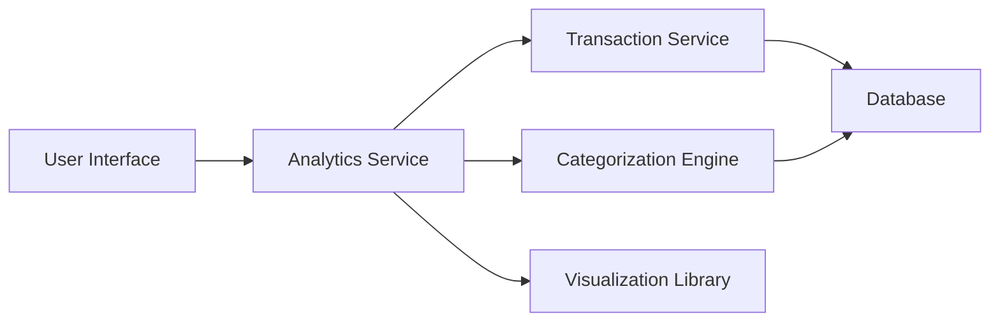

#### 1. High-Level Design

- **Summary:** This epic provides interactive visualizations and analytics to help users understand spending patterns across nine predefined categories (Food & Dining, Fuel, Shopping, Travel, Entertainment, Utilities, Healthcare, Education, and Miscellaneous). The feature includes monthly spend trend analysis and interactive charts, enabling users to identify spending hotspots and adjust financial behavior.

- **Component Flow:**

- **Integration Points:**
  - **Upstream:** Transaction Service (for raw transaction data)
  - **Upstream:** Categorization Engine (for assigning transactions to spending categories)
  - **Frontend:** Visualization Library (for rendering interactive charts and graphs)
  - **Data Store:** Database containing transaction records and category mappings

- **Key Assumptions:**
  - Transactions are auto-categorized using merchant codes or merchant names; manual recategorization is not supported in this epic.
  - Monthly trends display data for the current month and up to 12 previous months for year-over-year comparison.

- **NFR Highlights:** Visualizations must render within 1 second of data load; System must handle transaction categorization for up to 10,000 transactions per user; Charts must be interactive and responsive across all devices.

#### 2. Validation Report

- **Requirements Coverage:** The design comprehensively covers all requirements including category-wise spending visualization across nine categories, monthly spend trends, interactive charts and graphs, spending pattern analysis, transaction categorization, and trend comparison. The architecture integrates with the transaction service, categorization engine, and visualization library as specified in dependencies. The design supports the stringent NFRs including sub-1-second visualization rendering and handling of up to 10,000 transactions per user through efficient data aggregation and caching strategies.