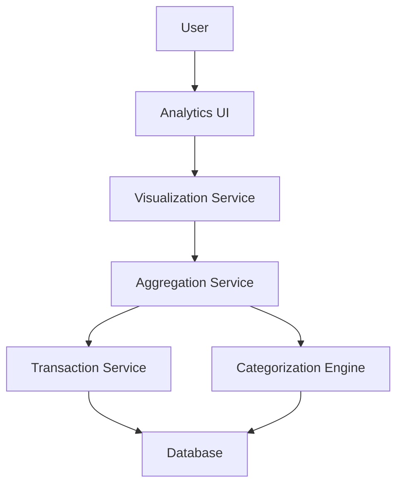

#### 1. High-Level Design

- **Summary:** This epic provides interactive visualizations for analyzing spending patterns across nine predefined categories (Food & Dining, Fuel, Shopping, Travel, Entertainment, Utilities, Healthcare, Education, Miscellaneous) with monthly spend trend analysis to identify spending hotspots and enable informed budgeting decisions.

- **Component Flow:**

- **Integration Points:**
  - **Upstream:** Transaction Service (raw transaction data), Categorization Engine (assigns transactions to spending categories), Visualization Library (chart rendering)
  - **Downstream:** Interactive Analytics UI with responsive charts and graphs

- **Key Assumptions:** 
  - Transaction categorization is automated using the categorization engine and stored with each transaction to avoid real-time categorization overhead.
  - The system supports up to 10,000 transactions per user with efficient indexing and aggregation queries to meet the 1-second visualization rendering requirement.

- **NFR Highlights:** Visualizations must render within 1 second of data load; system must handle transaction categorization for up to 10,000 transactions per user; charts must be interactive and responsive across all devices.

#### 2. Validation Report

- **Requirements Coverage:** The design comprehensively addresses all scope elements including category-wise spending visualization, monthly spend trends, interactive charts, spending pattern analysis across nine categories, transaction categorization, and trend comparison. The architecture is optimized to meet the 1-second rendering requirement through pre-computed categorization and efficient aggregation. All stated dependencies and NFRs are satisfied.