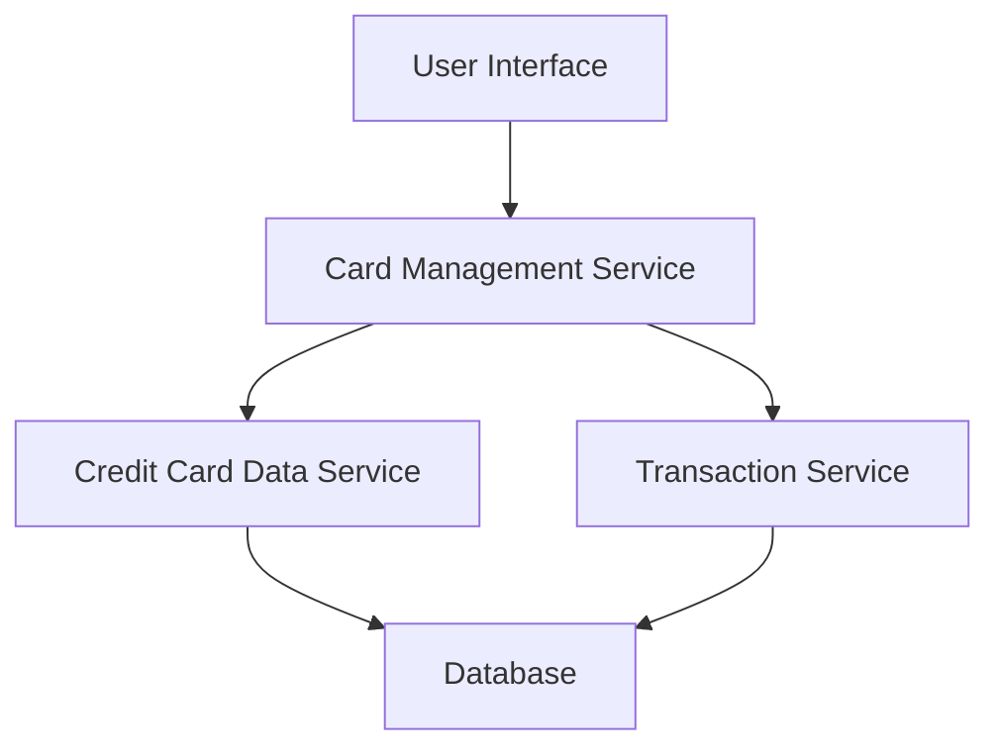

#### 1. High-Level Design

- **Summary:** This epic allows users to manage and monitor up to 20 credit cards from a single interface, view card-specific details (limits, balances), and analyze card-wise spending patterns to optimize credit card usage strategy.

- **Component Flow:**

- **Integration Points:**
  - **Upstream:** Credit Card Data Service (card information, limits, balances), Transaction Service (card-wise spending data)
  - **Downstream:** Card Management UI (displays multiple cards with filtering and selection capabilities)

- **Key Assumptions:** 
  - Card data retrieval is optimized to fetch all cards for a user in a single API call to meet the 2-second performance requirement.
  - Card-wise spend analysis aggregates transactions by card ID and displays totals for the current billing cycle or month.

- **NFR Highlights:** System must support management of up to 20 credit cards per user; card data retrieval must complete within 2 seconds; interface must be responsive across all device types.

#### 2. Validation Report

- **Requirements Coverage:** The design fully covers the epic's scope including multiple credit card display, card-wise spend analysis, individual card balance tracking, card details viewing, credit limit display, and card selection/filtering. The architecture is designed to meet the 2-second retrieval requirement and support up to 20 cards per user. All integration dependencies are addressed.