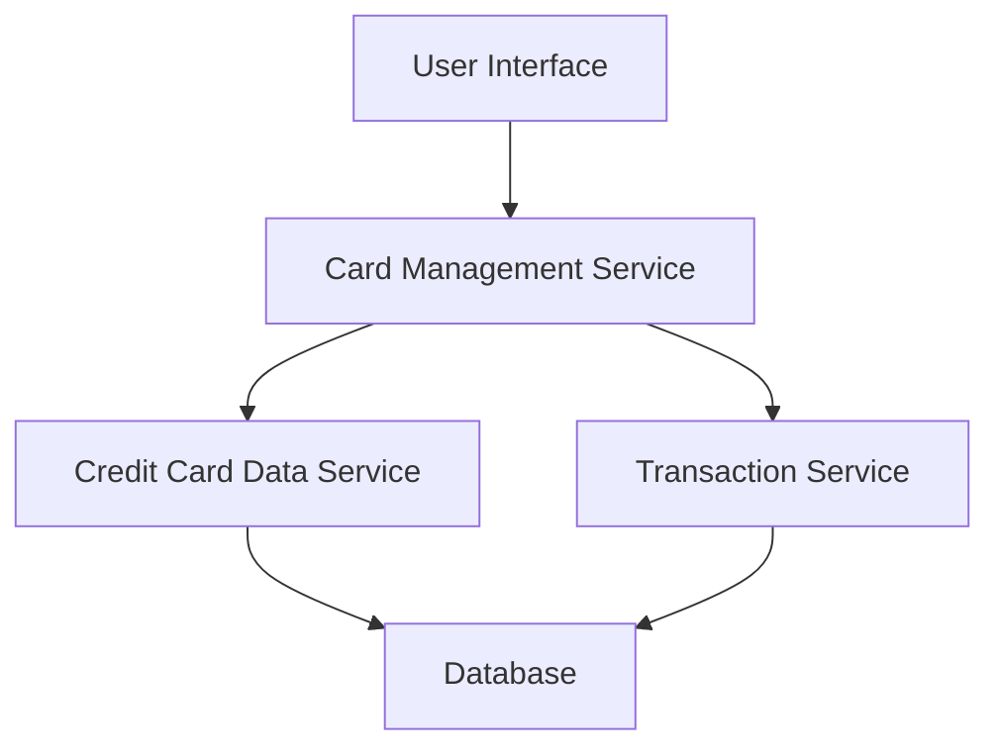

#### 1. High-Level Design

- **Summary:** This epic enables users to manage and monitor multiple credit cards from a single interface. Users can view all their credit cards, access card-specific details, analyze card-wise spending patterns, and track individual card balances and limits. The feature supports up to 20 credit cards per user and provides card selection and filtering capabilities.

- **Component Flow:**

- **Integration Points:**
  - **Upstream:** Credit Card Data Service (for card information including details, limits, and balances)
  - **Upstream:** Transaction Service (for card-wise spending data and transaction history)
  - **Data Store:** Database containing credit card master data and transaction records

- **Key Assumptions:**
  - Card data is retrieved via REST API calls with pagination support for users with multiple cards.
  - Card-wise spend analysis aggregates transactions by card ID for the current billing cycle or calendar month.

- **NFR Highlights:** System must support management of up to 20 credit cards per user; Card data retrieval must complete within 2 seconds; Interface must be responsive across all device types.

#### 2. Validation Report

- **Requirements Coverage:** The design fully addresses the epic's scope including multiple credit card display, card-wise spend analysis, individual card balance tracking, card details viewing, card-specific credit limit display, and card selection/filtering. The architecture integrates with both the credit card data service and transaction service as specified in dependencies. The design supports the NFR of managing up to 20 cards with sub-2-second retrieval times through efficient service layer design.