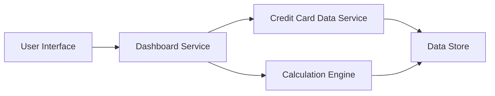

#### 1. High-Level Design

- **Summary:** This epic delivers a consolidated dashboard that displays key performance indicators (KPIs) for the user's credit card portfolio, including monthly spend, total credit limit, available credit, and outstanding amounts. The dashboard provides real-time visibility into overall credit card health, enabling users to make informed financial decisions.

- **Component Flow:**

- **Integration Points:**
  - **Upstream:** Credit Card Data Service (for retrieving card balances and transaction data)
  - **Upstream:** Calculation Engine (for aggregating KPIs across multiple cards)
  - **Data Store:** Database containing credit card and transaction information

- **Key Assumptions:**
  - KPI calculations are performed server-side with cached results updated at regular intervals (e.g., every 5 minutes) to support "real-time" refresh.
  - Available credit is calculated as (Total Credit Limit - Outstanding Amount) without considering pending transactions.

- **NFR Highlights:** Dashboard must be responsive across desktop, tablet, and mobile devices; KPI data must refresh in real-time; System must support concurrent viewing by multiple users.

#### 2. Validation Report

- **Requirements Coverage:** The design covers all stated requirements including monthly spend display, total credit limit tracking, available credit calculation, outstanding amount monitoring, responsive dashboard layout, and KPI visualization. The component flow demonstrates integration with the credit card data service and calculation engine as specified in dependencies. The architecture supports real-time data refresh and multi-device responsiveness as required by NFRs.