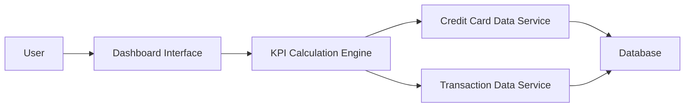

#### 1. High-Level Design

- **Summary:** This epic enables users to view a consolidated dashboard with real-time KPIs for their credit card portfolio, including monthly spend, total credit limit, available credit, and outstanding amounts. The dashboard provides unified visibility into overall credit card financial health.

- **Component Flow:**

- **Integration Points:**
  - **Upstream:** Credit Card Data Service (card balances and limits), Transaction Data Service (transaction data for monthly spend), Calculation Engine (aggregates KPIs across multiple cards)
  - **Downstream:** Responsive Dashboard Interface (displays real-time KPIs)

- **Key Assumptions:** 
  - KPI refresh is triggered on dashboard load and uses cached data with periodic background updates (e.g., every 30 seconds) to balance real-time requirements with system load.
  - Monthly spend KPI reflects the current calendar month's transactions.

- **NFR Highlights:** Dashboard must be responsive across desktop, tablet, and mobile devices; KPI data must refresh in real-time; system must support concurrent viewing by multiple users.

#### 2. Validation Report

- **Requirements Coverage:** The design addresses all scope items including monthly spend display, total credit limit tracking, available credit calculation, outstanding amount monitoring, responsive layout, and KPI visualization. The architecture supports real-time data refresh and concurrent user access through efficient caching and scalable service design. All stated dependencies are incorporated.