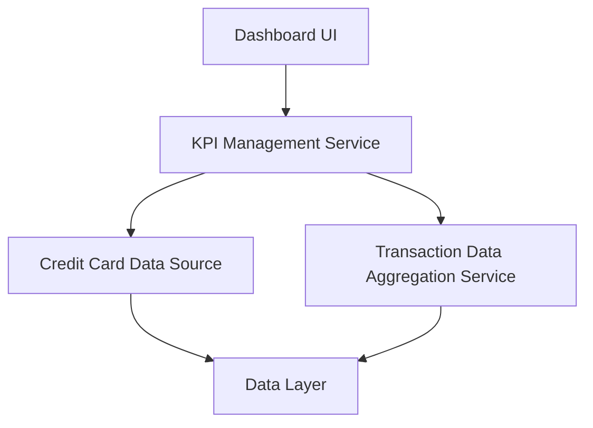

#### 1. High-Level Design

- **Summary:** This epic delivers a modern, responsive dashboard providing a consolidated view of all credit cards with key performance indicators: monthly spend, total credit limit, available credit, and outstanding amount. The dashboard serves as the central interface for monitoring credit card portfolio health and financial metrics at a glance.

- **Component Flow:**

- **Integration Points:**
  - **Upstream:** Credit Card Data Source (provides card details, limits, and balances)
  - **Upstream:** Transaction Data Aggregation Service (aggregates transaction data for monthly spend and outstanding calculations)
  - **Downstream:** Responsive UI (renders dashboard across devices)

- **Key Assumptions:** 
  - KPI calculations are performed server-side with caching strategies to meet performance requirements.
  - Transaction Data Aggregation Service provides pre-aggregated monthly spend metrics to reduce computation overhead.

- **NFR Highlights:** System must provide responsive layouts across devices; Dashboard must load and display KPIs with acceptable performance for multiple credit cards.

#### 2. Validation Report

- **Requirements Coverage:** The design addresses all scope requirements including dashboard KPIs display, monthly spend tracking, total credit limit aggregation, available credit calculation, outstanding amount tracking, multiple credit card view, and responsive layout design. Dependencies on credit card data source and transaction data aggregation service are incorporated. NFRs for responsive layouts and acceptable performance are acknowledged.