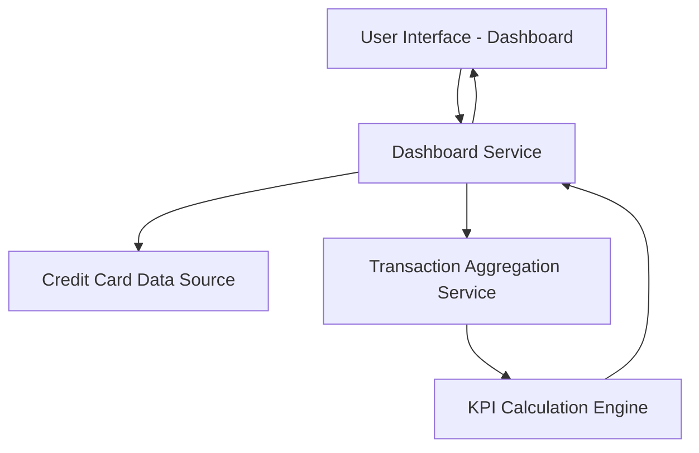

#### 1. High-Level Design

- **Summary:** This epic delivers a centralized, responsive dashboard that aggregates and displays key performance indicators (KPIs) for a user's credit card portfolio. Core metrics include monthly spend, total credit limit, available credit, and outstanding amounts across multiple cards, enabling users to monitor their financial health at a glance.

- **Component Flow:**

- **Integration Points:**
  - **Upstream:** Credit card data source (provides card details, limits, balances)
  - **Upstream:** Transaction data aggregation service (provides spend calculations)
  - **Downstream:** User interface layer (consumes KPI data for display)

- **Key Assumptions:** 
  - KPI calculations are performed server-side with near real-time data refresh.
  - Dashboard supports a reasonable upper limit of credit cards per user (e.g., up to 20 cards).

- **NFR Highlights:** Responsive layouts across devices; acceptable performance for loading and displaying KPIs for multiple credit cards.

#### 2. Validation Report

- **Requirements Coverage:** The design addresses all stated scope items including KPI display, monthly spend tracking, credit limit aggregation, available credit calculation, outstanding amount tracking, multiple card view, and responsive layout. Integration dependencies with credit card data source and transaction aggregation service are identified and incorporated into the component flow. NFRs for responsiveness and performance are acknowledged in the architecture.