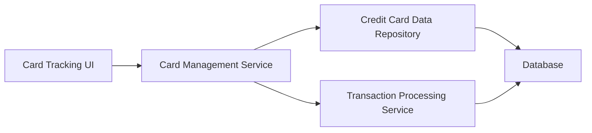

#### 1. High-Level Design

- **Summary:** This epic provides a unified interface for managing and monitoring multiple credit cards, offering comprehensive visibility into each card's details, balances, and credit utilization. Users can view all cards in one place, track individual card performance, and understand their overall credit portfolio through seamless card addition and viewing capabilities.

- **Component Flow:**

- **Integration Points:**
  - **Upstream:** Credit Card Data Repository (stores and retrieves card details and balances)
  - **Upstream:** Transaction Processing Service (calculates card-wise spend and balances)
  - **Downstream:** User Interface (displays card list and tracking information)

- **Key Assumptions:** 
  - Credit Card Data Repository provides normalized card data accessible via standard CRUD operations.
  - Card-wise spend calculations are performed by Transaction Processing Service with aggregation by card identifier.

- **NFR Highlights:** System must support display and management of multiple credit cards simultaneously; Interface must maintain responsiveness with increasing number of cards.

#### 2. Validation Report

- **Requirements Coverage:** The design covers all scope elements including multiple credit card display, card-wise spend analysis, individual card details view, credit card listing, and card-wise balance tracking. Dependencies on credit card data repository and transaction processing service are integrated. NFRs for supporting multiple cards simultaneously and maintaining responsiveness are addressed.