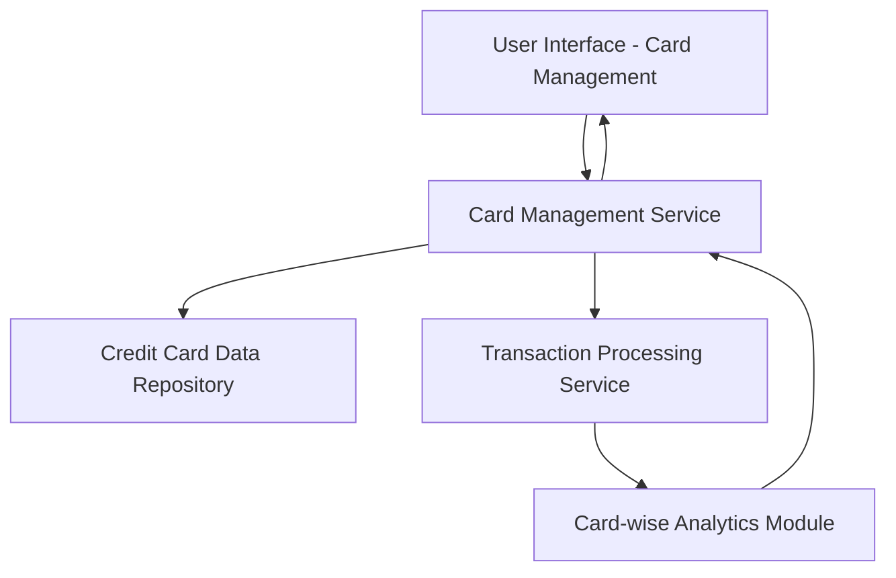

#### 1. High-Level Design

- **Summary:** This epic provides users with a unified interface to manage and monitor multiple credit cards, offering comprehensive visibility into individual card details, balances, credit utilization, and card-wise spending. It consolidates the entire credit card portfolio into a single view for efficient tracking and management.

- **Component Flow:**

- **Integration Points:**
  - **Upstream:** Credit card data repository (stores and retrieves card details and balances)
  - **Upstream:** Transaction processing service (provides card-wise spend calculations)
  - **Downstream:** User interface (displays card listings and individual card details)

- **Key Assumptions:** 
  - Card data is synchronized periodically from the repository with acceptable latency.
  - Card-wise spend analysis aggregates transactions on a daily or near-real-time basis.

- **NFR Highlights:** Must support display and management of multiple credit cards simultaneously; interface must maintain responsiveness with increasing number of cards.

#### 2. Validation Report

- **Requirements Coverage:** The design covers all scope elements including multiple credit card display, card-wise spend analysis, individual card details view, credit card listing, and card-wise balance tracking. Dependencies on credit card data repository and transaction processing service are explicitly mapped. NFRs regarding multi-card support and interface responsiveness are incorporated into the architectural considerations.