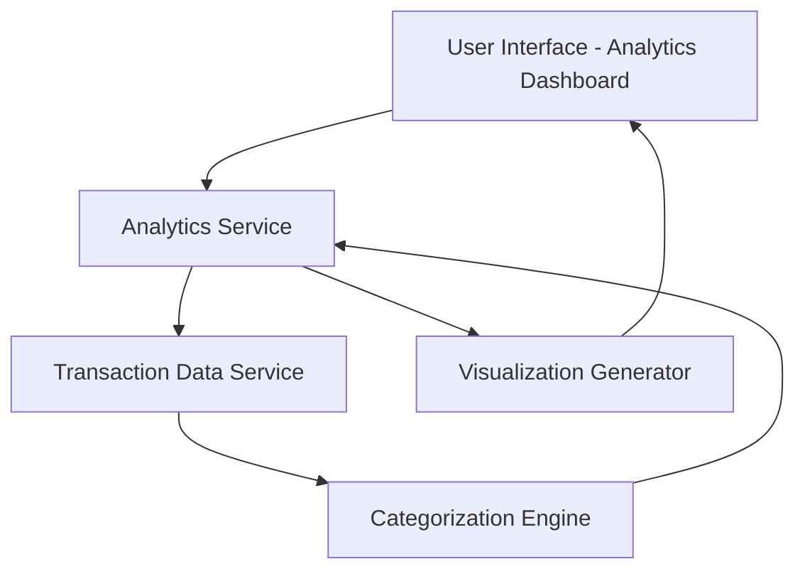

#### 1. High-Level Design

- **Summary:** This epic enables users to visualize and analyze their spending patterns through interactive charts and category-wise breakdowns. It supports nine predefined spending categories (Food & Dining, Fuel, Shopping, Travel, Entertainment, Utilities, Healthcare, Education, Miscellaneous) and provides monthly trend analysis to help users make informed financial decisions.

- **Component Flow:**

- **Integration Points:**
  - **Upstream:** Transaction data service (provides raw transaction records)
  - **Upstream:** Categorization engine (classifies transactions into predefined categories)
  - **Downstream:** Dashboard service (consumes analytics data for integrated display)
  - **Downstream:** Visualization layer (renders interactive charts and graphs)

- **Key Assumptions:** 
  - Transactions are automatically categorized using predefined rules or ML-based classification.
  - Historical transaction data is retained for trend analysis (at least 12-24 months).

- **NFR Highlights:** Analytics visualizations must be interactive and responsive; system must efficiently process and categorize transaction data for analytics generation.

#### 2. Validation Report

- **Requirements Coverage:** The design fully addresses the scope including category-wise spending visualization, monthly spend trends analysis, interactive charts and graphs, spending pattern identification, multi-category analytics across all nine categories, and transaction categorization. All dependencies (transaction data service, categorization engine, dashboard service) are identified and integrated into the component architecture. NFRs for interactivity, responsiveness, and efficient data processing are reflected in the design considerations.