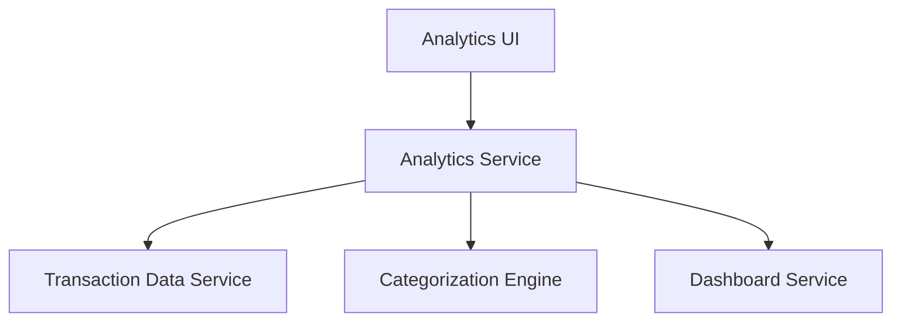

#### 1. High-Level Design

- **Summary:** This epic delivers interactive visualizations and analytics for understanding spending patterns through category-wise analysis (9 categories: Food & Dining, Fuel, Shopping, Travel, Entertainment, Utilities, Healthcare, Education, Miscellaneous) and monthly spend trends. The solution provides actionable insights based on historical spending data to support better financial planning.

- **Component Flow:**

- **Integration Points:**
  - **Upstream:** Transaction Data Service (provides raw transaction data)
  - **Upstream:** Categorization Engine (classifies transactions into predefined categories)
  - **Downstream:** Dashboard Service (integrates analytics into main dashboard display)

- **Key Assumptions:** 
  - Categorization Engine uses rule-based or ML-based classification to automatically assign transactions to one of the 9 categories.
  - Analytics Service aggregates data on-demand or uses pre-computed summaries for performance optimization.

- **NFR Highlights:** Analytics visualizations must be interactive and responsive; System must efficiently process and categorize transaction data for analytics generation.

#### 2. Validation Report

- **Requirements Coverage:** The design addresses all scope items including category-wise visualization, monthly trends analysis, interactive charts, spending pattern identification, multi-category analytics (9 categories), and transaction categorization. Dependencies on transaction data service, categorization engine, and dashboard service are incorporated. NFRs for interactivity, responsiveness, and efficient processing are acknowledged.