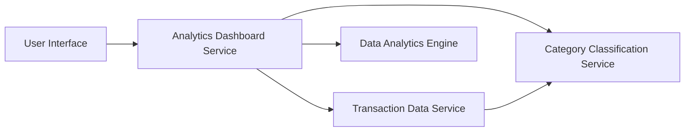

#### 1. High-Level Design

- **Summary:** This epic provides interactive analytics and visualization capabilities for users to understand spending patterns through category-wise breakdowns and monthly trend analysis. The system categorizes transactions into nine predefined categories (Food & Dining, Fuel, Shopping, Travel, Entertainment, Utilities, Healthcare, Education, Miscellaneous) and displays spending trends over time with interactive charts that render within 2 seconds.

- **Component Flow:**

- **Integration Points:**
  - **Upstream:** Transaction data service (retrieving spending records), Data analytics engine (trend calculation), Category classification service (transaction categorization)
  - **Downstream:** Interactive visualization components rendering charts and category breakdowns

- **Key Assumptions:**
  - Transaction categorization is automated using predefined rules or machine learning (categorization logic not specified in epic)
  - Historical transaction data for at least 12 months is available and accessible for trend analysis

- **NFR Highlights:** Analytics visualizations must render within 2 seconds; Charts must be interactive and responsive; System must handle transaction history for at least 12 months; Category calculations must be accurate and consistent

#### 2. Validation Report

- **Requirements Coverage:** The design comprehensively covers all scope elements including category-wise spending visualization, monthly spend trend charts, interactive analytics dashboard, nine spending category classifications, transaction categorization, spending pattern analysis, time-based trend analysis, and visual data representation. The architecture separates concerns appropriately with dedicated services for transaction retrieval, categorization, analytics processing, and visualization, ensuring the 2-second rendering NFR can be met through optimized data processing and caching strategies.