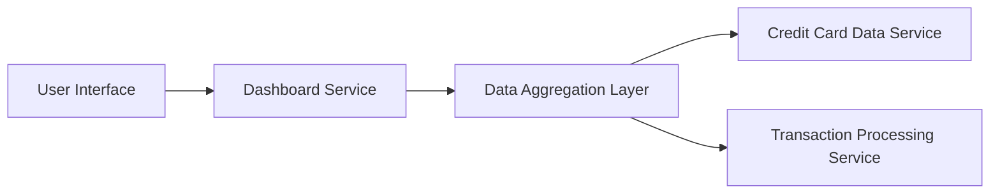

#### 1. High-Level Design

- **Summary:** This epic delivers a centralized, responsive dashboard that consolidates key performance indicators (KPIs) for all user credit cards. The dashboard displays monthly spend, total credit limit, available credit, and outstanding amounts in a single view, enabling users to monitor their credit card portfolio health and make informed financial decisions quickly.

- **Component Flow:**

- **Integration Points:**
  - **Upstream:** Credit card data service (for card details and balances), Transaction processing service (for monthly spend and outstanding amounts)
  - **Downstream:** User interface layer consuming aggregated KPI data

- **Key Assumptions:** 
  - KPI data is refreshed at regular intervals (assumed near-real-time, specific refresh frequency not defined in epic)
  - Credit card data service provides standardized API responses for all card types

- **NFR Highlights:** Dashboard must be responsive across desktop, tablet, and mobile devices; Page load time must be optimized for quick access to KPIs; UI must support real-time or near-real-time data refresh

#### 2. Validation Report

- **Requirements Coverage:** The design fully covers the epic's stated scope including dashboard UI development, all four KPI displays (monthly spend, total credit limit, available credit, outstanding amount), responsive layout, and consolidated multi-card view. The component flow addresses data retrieval, aggregation, and presentation layers required for the dashboard functionality.