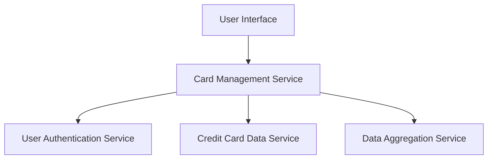

#### 1. High-Level Design

- **Summary:** This epic enables users to view and manage multiple credit cards (up to 10 per user) within a unified interface. Users can view all registered cards, access individual card details, track card-specific metrics, and switch between cards for detailed analysis. The system provides both a consolidated portfolio view and individual card drill-down capabilities.

- **Component Flow:**

- **Integration Points:**
  - **Upstream:** Credit card data service (card information retrieval), User authentication service (card ownership validation), Data aggregation service (multi-card calculations)
  - **Downstream:** UI components for card list display, card details view, and card-wise analytics

- **Key Assumptions:**
  - Card registration process assumes cards are pre-registered (registration mechanism not detailed in epic)
  - Card ownership validation occurs at authentication layer before card data is displayed

- **NFR Highlights:** System must support management of at least 10 credit cards per user; Card data retrieval must be efficient with minimal latency; Data consistency must be maintained across all card views

#### 2. Validation Report

- **Requirements Coverage:** The design addresses all scope elements including multiple card registration and display, individual card details view, card-specific metrics tracking, card selection/navigation, card list management, and card-wise spend analysis visualization. The architecture supports both the consolidated view and individual card drill-down requirements with appropriate service separation for authentication, data retrieval, and aggregation.